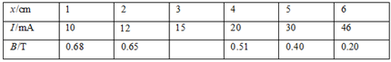

# Physics - 题目 626

**ID**: 1ddcc686423949d38c62fc39e642086a
**年级**: Grade 9
**难度**: Medium-Hard
**题型**: Experiment

## 题目
磁感应强度 $B$ 用来描述磁场的强弱，国际单位是特斯拉，符号“ ${\rm{T}}$ ”为了探究磁铁外轴线上感应强度的大小与哪些因素有关，小翼设计了如图所示的电路，图甲电源电压 $6{\rm{V}}$ ， $R$ 为磁感电阻．其阻值随磁感应强度变化的关系图线如图．（ $1$ ）当图乙 ${\rm{S}}{{}_{2}}$ 断开，图甲 ${\rm{S}}{{}_{{\rm{1}}}}$ 闭合时，电流表的示数为${\rm{m}}{\rm{A}}$ ．闭合 ${\rm{S}}{{}_{{\rm{1}}}}$ 和 ${\rm{S}}{{}_{2}}$ ，滑动变阻器的滑片 $P$ 移动时，图甲中电流表的示数逐渐减小，说明磁感电阻 $R$ 处的磁感应强度 $B$ 逐渐．（ $2$ ）闭合 ${\rm{S}}{{}_{{\rm{1}}}}$ 和 ${\rm{S}}{{}_{2}}$ ，滑片 $P$ 不动，沿电磁铁轴线向左移动磁感电阻 $R$ ，测出 $R$ 离电磁铁左端的距离 $x$ 与对应的电流表示数 $I$ ，算出 $R$ 处磁感应强度 $B$ 的数值如表．请计算 $x=5{\rm{c}}{\rm{m}}$ 时， $B=$${\rm{T}}$ ．（3）综合以上实验数据可以得出：电磁铁外轴线上磁感应强度离电磁铁越远，磁感应强度越．​​​​​​​‌

## 解答

1. （1）当图乙S2断开，图甲S1闭合时，即磁场强度为零，据图丙可知，此时的R＝100Ω，故此时电路中的电流是：I＝ $\frac {U}{R}＝\frac {6{\rm{V}}}{100{\rm{Ω}}}$  ＝0.06A＝60mA；图乙中滑动变阻器的滑片P向右移动，有效电阻变小，电流变大磁场变强，图甲中电流表的示数逐渐减小，即R的电阻变大，据此分析可知：磁感应电阻R处的磁感应强度B逐渐增大；（2）x＝5cm时，对于图表得出电流是30mA，据欧姆定律可知：R′＝ $\frac {U}{I^{′}}$  ＝ $\frac {6{\rm{V}}}{0.03{\rm{A}}}$ ＝200Ω，故对应磁场的强度是0.40T；（3）综合以上实验数据，分析（2）中的表格数据可以得出“电磁铁外轴线上磁感应强度随电磁铁电流的增大而增大，离电磁铁越远，磁感应强度越小．
2. 点睛：据题可知，此时的电源电压是6V，且此时的磁场强度为零，根据欧姆定律求出电流表的示数；图乙中滑动变阻器的滑片P向右移动，图甲中电流表的示数逐渐减小，据此分析即可判断规律；x＝5cm时，对于图表得出电流是30mA，根据欧姆定律可以判断电阻大小，进而判断磁场的强弱，继而可判断出变化的规律．

## 知识点

**中文**:
  - 磁化的利用与防止

**English**:
  - Use and Prevention of Magnetization

---
