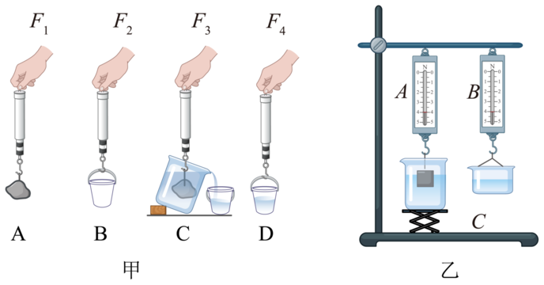

# Physics - 题目 219

**ID**: 2106578479e0463a9d7885fc674e902c
**年级**: Grade 9
**难度**: Medium-Hard
**题型**: Experiment

## 题目
某班物理实验小组的同学，利用图甲验证阿基米德原理。​​​​​​​‌（1）方案一：小军用石块按照如图甲所示的实验步骤依次进行实验，为减小测量误差并使操作最简便，最合理的操作步骤应该是；①ACDB；；；②ABCD；；；；③BACD；；；；   ④CADB（2）如图甲所示，物体受到的浮力F_{浮}＝，物体排开液体的重力等于。若它们相等，则阿基米德原理成立。（两空均用测力计示数所对应的字母表示）（3）在采用图甲所示的方式进行实验时，若测力计在整个过程中都没有进行调零，则小明得出F_{浮}＝G_{排}；若小空桶的桶壁上一开始粘有水，则小明得出F_{浮}＝G_{排}。（两空均选填“能”或“不能”）。（4）方案二：如图乙所示，小川同学将装满水的溢水杯放在升降台C上，当小川缓慢调高升降台，且容器不与重物接触时，发现随着重物浸入水中的体积越来越大，弹簧测力计A的示数（选填“变大”、“变小”或“不变”），且弹簧测力计A示数的变化量B示数的变化量（选填“大于”、“小于”或“等于”），从而证明了F_{浮}＝G_{排}。在这个过程中溢水杯对升降台C的压力（选填“变大”、“变小”或“不变”）。

## 解答

1. （1）[1]为了减小误差并且操作最简便，可以先测量小桶的重力，再测量物体的重力，故顺序为BACD。
2. （2）[2]根据
3. $F{{}_{浮}}＝G﹣F$
4. 可知，石块浸没在水中受到的浮力
5. $F{{}_{浮}}＝F{{}_{1}}﹣F{{}_{3}}$
6. [3]排开水的重力
7. $G{{}_{排}}＝F{{}_{4}}﹣F{{}_{2}}$
8. 若它们相等，则阿基米德原理成立。
9. （3）[4]若弹簧测力计都没有校零，那么四次测量结果都应减去测量前弹簧测力计示数，那么所得浮力与排开水的重力大小仍然相等，所以能得出F_{浮}=G_{排}。
10. [5]若小空桶的桶壁上一开始粘有水，求排开水的重力
11. $G{{}_{排}}＝F{{}_{4}}﹣F{{}_{2}}$
12. 则求排开水的重力G_{排}不受影响，因此仍能得出
13. $F{{}_{浮}}＝G{{}_{排}}$
14. （4）[6]重物浸入水中的体积越来越大时，排开液体的体积变大，根据
15. $F{{}_{浮}}＝ρ{{}_{液}}gV{{}_{排}}$
16. 可知，重物受到的浮力变大，因为
17. $F{{}_{浮}}＝G﹣F{{}_{示}}$
18. 所以弹簧测力计A的示数
19. $F{{}_{示}}＝G﹣F{{}_{浮}}$
20. 变小。
21. [7]因为重物浸入水中的体积越来越大时，溢出水的体积变大、溢出水的质量变大、溢出水受到的重力变大，所以弹簧测力计B的示数变大；根据阿基米德原理可知，物体所受浮力的大小和排开液体的重力相等，所以弹簧测力计A示数的变化量和弹簧测力计B的示数变化量相等。
22. [8]将烧杯、水和物体看做一个整体，容器对升降台C的压力等于空杯和杯内水的总重与物体的重力之和再减去物体受到的拉力（大小等于测力计的示数），
23. 即
24. $F{{}_{压}}＝G{{}_{杯}}+G{{}_{杯内水}}+G{{}_{物}}﹣F{{}_{示}}$
25. 而
26. $G{{}_{物}}﹣F{{}_{示}}＝F{{}_{浮}}$
27. 所以
28. $F{{}_{压}}＝G{{}_{杯}}+G{{}_{杯内水}}+F{{}_{浮}}$
29. 根据阿基米德原理
30. $F{{}_{浮}}＝G{{}_{排水}}$
31. 所以
32. $F{{}_{压}}＝G{{}_{杯}}+G{{}_{杯内水}}+G{{}_{排水}}$
33. 由于杯内的水和排出的水的总重等于原来杯子里的水，是个定值，所以在这个过程中容器对升降台C的压力不变。

## 知识点

**中文**:
  - 实验探究阿基米德原理

**English**:
  - Experiment: Investigating Archimedes' Principle

---
