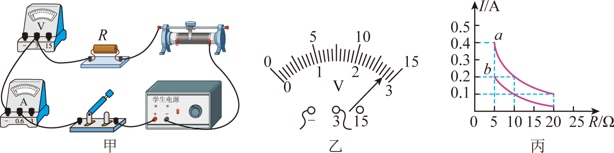

# Physics - 题目 1999

**ID**: 226002902b5246b9a6a07ba7c6268d21
**年级**: Grade 9
**难度**: Medium-Hard
**题型**: Experiment

## 题目
小明所在某实验小组进行探究“电流与电阻关系”的实验时，选取的电源电压为4.2V，定值电阻（5Ω、10Ω、20Ω各一个），滑动变阻器有A、B两个（A标有“10Ω　1A”字样、B标有“20Ω　0.6A”字样），他选取了其中一个变阻器和其他相关器材进行实验。​​​​​​​‌（1）用笔画线代替导线，补充一根导线将图甲所示的实物连接成完整电路；（要求连线不得交叉）（2）小明根据图甲正确连接电路，闭合开关（操作规范）后，电流表示数为0.14A，电压表示数如图乙所示，则小明在实验中选用的滑动变阻器是；（3）图丙中a，b是两个不同组的数据绘制的图像，用图甲的完整的实验电路在进行绘制 $a$ 图像的实验时，用5Ω的电阻做完实验后，接着把5Ω换为10Ω的电阻接入电路，闭合开关，应该向调节滑片位置，使电压表示数为V时，读出电流表的示数。a，b图像不重合的原因是；（4）完成上述实验之后，小明还想利用这套器材来测量一个标有“3.8V　0.3A”字样的小灯泡（其电阻随温度升高而变大）的电功率，他将定值电阻替换成小灯泡，调节滑动变阻器使小灯泡正常发光，判定该小灯正常发光的方法是。移动滑动变阻器，当电压表的示数为3V时，小灯泡的电功率的可能值为。（选填字母序号）

## 解答

1. （1）探究“电流与电阻关系”的实验时，将电压表并联在电阻R两端，如下图
2. 
3. （2）由（1）知道，电压表测电阻R两端电压；闭合开关（操作规范）后，电流表示数为0.14A，说明滑动变阻器接入电路的阻值最大；电压表示数如图乙所示，电压表选用小量程，分度值0.1V，其示数为2.8V；根据串联电路电压规律，滑动变阻器两端电压 $U{{}_{滑}}=U-U{{}_{1}}={{4}}{{.}}{{2}}{\rm{V}}{{-}}{{2}}{{.}}{{8}}{\rm{V}}{\rm{=}}{{1}}{{.}}{{4}}{\rm{V}}$ ，则滑动变阻器接入电路的阻值为 $R{{}_{滑}}=\frac {U{{}_{滑}}}{I{{}_{1}}}=\frac {{{1}}{{.}}{{4}}{\rm{V}}}{{{0}}{{.}}{{1}}{{4}}{\rm{A}}}{\rm{=}}{{1}}{{0}}{\rm{Ω}}$ ，故小明在实验中选用的滑动变阻器是A。
4. （3）由图丙a知道，定值电阻两端电压为 $U{{}_{{\rm{V}}}}=IR={{0}}{{.}}{{4}}{\rm{A}}\times {{5}}{\rm{Ω}}{\rm{=}}{{0}}{{.}}{{1}}{\rm{A}}\times {{2}}{{0}}{\rm{Ω}}{\rm{=}}{{2}}{\rm{V}}$ ，实验中，当把5Ω的电阻换成10Ω的电阻后，根据分压原理，电阻两端的电压变大，研究电流与电阻关系时要控制电压不变，根据串联电路电压的规律，要增大滑动变阻器两端的电压，由分压原理，要增大滑动变阻器电阻阻值，故应把滑动变阻器滑片向左滑动，使电压表示数为2V时，读出电流表的示数。由图丙b知道，定值电阻两端电压 $U^{′}{{}_{{\rm{V}}}}=IR=0.2{\rm{A}}\times {{5}}{\rm{Ω}}{\rm{=}}{{0}}{{.}}{{1}}{\rm{A}}\times {{1}}{{0}}{\rm{Ω}}{\rm{=}}{{1}}{\rm{V}}$ ，即图像不重合的原因是电阻R两端的电压预设值不同。
5. （4）调节滑动变阻器，当电压表示数为3.8V，即灯泡两端电压为额定电压时，小灯泡正常发光。一个标有“3.8V　0.3A”字样的小灯泡，正常发光时的电阻 $R{{}_{{\rm{L}}}}=\frac {U{{}_{{\rm{L}}}}}{I{{}_{{\rm{L}}}}}=\frac {{{3}}{{.}}{{8}}{\rm{V}}}{{{0}}{{.}}{{3}}{\rm{A}}}\approx {{1}}{{2}}{{.}}{{7}}{\rm{Ω}}$ ，当电压表的示数为3V时，若小灯泡的电功率为0.68W，此时灯丝的电阻 $R{{}_{1}}=\frac {U{^{2}}}{P{{}_{1}}}{\rm{=}}\frac {\left ({{{3}}{\rm{V}}}\right ){^{{{2}}}}}{{{0}}{{.}}{{6}}{{8}}{\rm{W}}}\approx {{1}}{{3}}{{.}}{{2}}{\rm{Ω}}$ ，若小灯泡的电功率为0.8W，此时灯丝的电阻 $R{{}_{2}}=\frac {U{^{2}}}{P{{}_{2}}}{\rm{=}}\frac {\left ({{{3}}{\rm{V}}}\right ){^{{{2}}}}}{{{0}}{{.}}{{8}}{\rm{W}}}=11.25{\rm{Ω}}$ ，若小灯泡的电功率为0.9W，此时灯丝的电阻 $R{{}_{3}}=\frac {U{^{2}}}{P{{}_{1}}}{\rm{=}}\frac {\left ({{{3}}{\rm{V}}}\right ){^{{{2}}}}}{{{0}}{{.}}{{9}}{\rm{W}}}=10{\rm{Ω}}$ ，因灯丝的电阻随温度的降低而减小，因此当灯泡两端电压为3V时的电阻应小于灯泡正常发光时的电阻；由于3V与3.8V的电压相差不大，当灯泡两端电压为3V时的电阻应该略小于3.8V时的电阻，即当电压表的示数为3V时，小灯泡的电功率的可能值为0.8W。

## 知识点

**中文**:
  - 实际电压与实际功率
  - 电流与电阻关系的探究实验

**English**:
  - Actual Voltage and Actual Power
  - Experiment: Relationship between Current and Resistance

---
