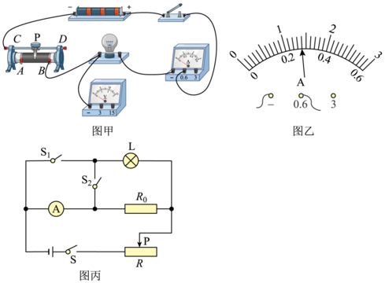

# Physics - 题目 1795

**ID**: 2a6b3ff627aa4bde86188add5c2c92ac
**年级**: Grade 9
**难度**: Medium-Hard
**题型**: Experiment

## 题目
小红同学想知道灯泡的亮度与实际功率的关系，选用额定电压是 $2.5{\rm{V}}$ 的灯泡，将它接在如图甲所示的电路中，电源电压恒为 $4.5{\rm{V}}$ 。​​​​​​​‌（1）图甲是小红未连接完整的电路，请你用笔画线代替导线，将电路补充完整。（2）闭合开关，发现小灯泡不亮，但电流表有示数，电压表无示数，发生故障原因可能是。（3）闭合开关，小红同学调节滑动变阻器的滑片，使电压表的示数为 $2.5{\rm{V}}$ ，小灯泡正常发光，此时电流表的示数如图乙所示，则该灯泡的额定功率是W。接下来若想测量灯泡在 $3{\rm{V}}$ 电压下的电功率，她应将滑片向滑动到适当位置。实验次数电压 $U/{\rm V}$电流 $I/A$电功率 $P/W$亮度11.50.240.36较暗22.5正常33.00.381.14较亮（4）分析表中数据可得出结论：灯泡的实际电功率随电压的增大而（选填“增大”“不变”或“减小” ），灯泡的亮度由灯泡决定。（5）由于电压表损坏，于是想出一种测量该灯泡额定功率的方法，电路设计如图丙所示， $R{{}_{0}}$ 为已知阻值的定值电阻，请将以下实验步骤补充完整。①检查电路无误后，闭合开关 ${\rm{S}}$ 、 ${\rm{S}}{{}_{1}}$ ，断开 ${\rm{S}}{{}_{2}}$ ，调节滑动变阻器的滑片直至电流表示数为 $\frac {U{{}_{{\rm{额}}}}}{R{{}_{{\rm{0}}}}}$ 时，小灯泡正常发光。②保持滑动变阻器滑片的位置不动，断开 ${\rm{S}}{{}_{1}}$ ，闭合 ${\rm{S}}{{}_{2}}$ ，读出电流表的示数为 $I$ 。③小灯泡的额定功率表达式 $P{{}_{\mathrm{额}}}=$（请用含有 $U{{}_{额}}$ 、 $R{{}_{0}}$ 、 $I$ 的式子表示）。

## 解答

1. （1）[1]灯泡的额定电压是 $2.5{\rm{V}}$ ，故电压表选用小量程与灯泡并联，如下图所示：
2. 
3. （2）[2]闭合开关，发现小灯泡不亮，但电流表有示数，说明电路为通路，电压表无示数，说明电压表与导线并联，即小灯泡短路。
4. （3）[3]电流表的示数如图乙所示，电流表选用小量程，分度值 $0.02{\rm{A}}$ ，电流表示数为 $0.28{\rm{A}}$ ，根据 $P=UI$ 可知，小灯泡的额定功率为
5. $P=UI=2.5{\rm{V}}\times 0.28{\rm{A}}=0.7{\rm{W}}$
6. [4]接下来若想测量灯泡在 $3{\rm{V}}$ 电压下的电功率，根据串联分压原理，应减小滑动变阻器两端电压，增大小灯泡两端电压，要使滑动变阻器两端电压减小需减小滑动变阻器的电阻，故滑片应向右移动。
7. （4）[5][6]由表中数据可知，第1、2、3的电功率分别为 $0.36{\rm{W}}$ 、 $0{\rm{.}}7{\rm{W}}$ 、 $1.14{\rm{W}}$ ，可得出结论：小灯泡工作时，消耗的电功率随电压的增大而增大；小灯泡的亮度由实际功率决定。
8. （5）[7]①检查电路无误后，闭合开关 ${\rm{S}}$ 、 ${\rm{S}}{{}_{1}}$ ，断开 ${\rm{S}}{{}_{2}}$ ，调节滑动变阻器的滑片直至电流表示数为 $\frac {U{{}_{{\rm{额}}}}}{R{{}_{0}}}$ 时，小灯泡正常发光，此时 $R{{}_{0}}$ 与灯泡并联。②闭合 ${\rm{S}}{{}_{2}}$ 、 ${\rm{S}}$ ，断开 ${\rm{S}}{{}_{1}}$ ，灯 ${\rm{L}}$ 与电阻 $R{{}_{0}}$ 仍然并联，此时电流表测干路电流，电流表的示数为 $I$ ，因保持滑片位置不变，因电路的连接关系没有改变，各电阻的大小和通过的电流不变，灯仍正常发光，根据并联电路电流的规律可得，灯泡正常发光时的电流
9. $I{{}_{额}}=I-\frac {U{{}_{额}}}{R{{}_{0}}}$
10. ③灯的额定功率
11. $P{{}_{额}}=U{{}_{额}}I{{}_{额}}=U{{}_{额}}\left ({I-\frac {U{{}_{额}}}{R{{}_{0}}}}\right )$

## 知识点

**中文**:
  - 伏安法测量小灯泡的电功率
  - 其他方法测量小灯泡的电功率

**English**:
  - Measuring Bulb Power (Voltammetry)
  - Other Methods for Measuring Bulb Power

---
