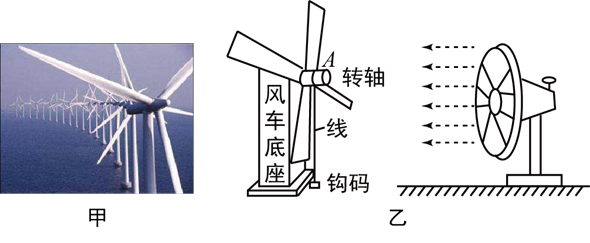

# Physics - 题目 2050

**ID**: 2a8c11b1e28a4aa89587144a18de0f05
**年级**: Grade 9
**难度**: Medium-Hard
**题型**: Experiment

## 题目
某兴趣小组的同学在探究“风力发电机发电时的输出功率与风速的关系”时，设计了如下实验步骤：①如图乙，将自制的小型风叶安装在风车底座上，把线的一端固定在风车转轴上，另一端系上钩码；②在风车正前方1米处放置电风扇的风速调到1挡位，用秒表记录提升钩码到A点所需的时间；③将电风扇换到2、3挡位，重复以上实验，并将数据记录在表格中：(注：电风扇挡位越高，风速越大)表一：电风扇挡位钩码的质量/g提升钩码到A点的时间/s150152501335010请你回答：(1)这个实验是通过测量提升钩码到A点的来比较风车输出功率的大小。​​​​​​​‌这种方法是(选填“控制变量法”或“转换法”)；(2)通过实验可以得到的结论是：风速越大，风力发电机发电时的输出功率；为了进一步研究风力发电机，他又从电厂查到一台1500kW的发电机组的相关数据：表二：输出功率与风速的关系风速v/(m/s)5101520输出功率P/kW8072015001100表三：不同风速下风力发电机每秒获得的风能：风速v(m/s)51015201s获得的能量E(10^{4}J)15120405350(3)风能是清洁能源，也是(选填“可再生”或“不可再生”)能源。发电机的工作原理是；(4)风速10m/s时，这台发电机的发电效率为，有同学认为风速越大，发电机的发电效率越高，他的观点是(选填“正确”或“错误”)的。你认为的原因是。

## 解答

1. (1)[1]因提升高度要相同，通过提升时间，可知提升速度的大小，则由
2. $P=\frac {W}{t}=\frac {mgh}{t}=mgv$
3. 可知输出功率的大小，故比较测量提升钩码到A点的时间来比较风车输出功率的大小。
4. [2]转换法可将不可测的量转换为可测的量进行测量，也可将不易测准的量转换为可测准的量，提高测量精度。此实验将风车输出功率的大小转化为通过测量提升钩码到A点的时间。
5. (2)[3]分析表一数据可见，在提升钩码质量相同的情况下，风速越大，提升钩码到A点的时间越短，风车的输出功率越大。
6. (3)[4]风能是一种很清洁的可再生能源，资源丰富，无污染。
7. [5]风力发电是将风能转化为电能，发电机是通过机械运动产生电能，即是利用电磁感应现象制成的，所以发电机的工作原理是电磁感应现象。
8. (4)[6]风速为10m/s时，1s内获得的能量为 ${\rm{1}}{\rm{.}}{\rm{2}}\times {\rm{1}}{\rm{0}}{^{{\rm{6}}}}{\rm{J}}$ ，风车工作1h获得的能量为
9. $W{{}_{总}}{\rm{=}}{\rm{1}}{\rm{.}}{\rm{2}}\times 1{\rm{0}}{^{{\rm{6}}}}{\rm{J}}{\rm{/}}{\rm{s}}\times {\rm{3}}{\rm{.}}{\rm{6}}\times {\rm{1}}{\rm{0}}{^{{\rm{3}}}}{\rm{s}}{\rm{=}}{\rm{4}}{\rm{.}}{\rm{3}}{\rm{2}}\times {\rm{1}}{\rm{0}}{^{{\rm{9}}}}{\rm{J}}$
10. 风车工作1h产生的电能为
11. $W{{}_{电}}{\rm{=}}{\rm{7}}{\rm{2}}{\rm{0}}{\rm{k}}{\rm{W}}\times {\rm{1}}{\rm{h}}{\rm{=}}{\rm{7}}{\rm{2}}{\rm{0}}{\rm{k}}{\rm{W}}\cdot {\rm{h}}{\rm{=}}{\rm{2}}{\rm{.}}{\rm{5}}{\rm{9}}{\rm{2}}\times {\rm{1}}{\rm{0}}{^{{\rm{9}}}}{\rm{J}}$
12. 风车发电的效率为
13. $η{\rm{=}}\frac {W{{}_{电}}}{W{{}_{总}}}\times {\rm{1}}{\rm{0}}{\rm{0}}{\rm{\%}}{\rm{=}}\frac {{\rm{2}}{\rm{.}}{\rm{5}}{\rm{9}}{\rm{2}}\times {\rm{1}}{\rm{0}}{^{{\rm{9}}}}{\rm{J}}}{{\rm{4}}{\rm{.}}{\rm{3}}{\rm{2}}\times {\rm{1}}{\rm{0}}{^{{\rm{9}}}}{\rm{J}}}\times {\rm{1}}{\rm{0}}{\rm{0}}{\rm{\%}}{\rm{=}}{\rm{6}}{\rm{0}}{\rm{\%}}$
14. [7][8]风速为15m/s时，1s内获得的能量为 ${\rm{4}}{\rm{.}}{\rm{0}}{\rm{5}}\times {\rm{1}}{\rm{0}}{^{{\rm{6}}}}{\rm{J}}$ ；风车工作1s产生的电能为 $1.5\times 10{^{6}}{\rm{J}}$ ，风车发电的效率为
15. $η{\rm{=}}\frac {W{{}_{电1}}}{W{{}_{总1}}}\times {\rm{1}}{\rm{0}}{\rm{0}}{\rm{\%}}{\rm{=}}\frac {{\rm{1}}{\rm{.}}{\rm{5}}\times {\rm{1}}{\rm{0}}{^{{\rm{6}}}}{\rm{J}}}{{\rm{4}}{\rm{.}}{\rm{0}}{\rm{5}}\times {\rm{1}}{\rm{0}}{^{{\rm{6}}}}{\rm{J}}}\times {\rm{1}}{\rm{0}}{\rm{0}}{\rm{\%}}{\rm{=}}{\rm{3}}{\rm{7}}{\rm{.}}{\rm{0}}{\rm{4}}{\rm{\%}}$
16. 由此可知，风速越大，发电机的发电效率越低，所以他的观点是错误的。

## 知识点

**中文**:
  - 能量的转化

**English**:
  - Transformation of Energy

---
