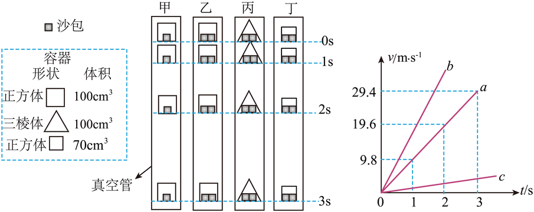

# Physics - 题目 1984

**ID**: 2b7382d5120b4104a68f4dda2dbfaaac
**年级**: Grade 9
**难度**: Medium-Hard
**题型**: Experiment

## 题目
2024年6月2日清晨，“嫦娥六号”成功着陆在月球背面南极—艾特肯盆地预选着陆区，探测器经历了减速、悬停、自由下落等复杂的运动过程。​​​​​​​‌为了解探测器在月球上自由下落的有关情况，学校科技小组开展了相关研究。第一步：实验探究。猜想1：没有空气阻力时，物体由静止状态释放，下落的速度可能与物体的质量有关；猜想2：没有空气阻力时，物体由静止状态释放，下落的速度可能与物体的体积有关；猜想3：没有空气阻力时，物体由静止状态释放，下落的速度可能与物体的形状有关；猜想4：没有空气阻力时，物体由静止状态释放，下落的速度可能与物体的下落时间有关。实验：如图所示，为了在地球上模拟月球表面没有空气的环境，实验均在抽真空的竖直管道内进行。实验时，将不同数量的相同沙包放入不同的容器内，依次进行了甲、乙、丙、丁四次实验，物体在0s时由静止落下，利用频闪摄影记录了物体在0s、1s、2s、3s时的位置。（各种容器的质量均相等，甲、乙两次实验均用100cm^{3}的正方体容器，丙实验用100cm^{3}的三棱体容器，丁实验用70cm^{3}的正方体容器）（1）分析频闪照片，比较甲、乙两次实验，可得结论：没有空气阻力时，物体由静止状态释放，下落的速度与物体的质量（选填“有关”或“无关”）；比较两次实验，可验证猜想3；综合分析四次实验，请你判断没有空气阻力时，物体由静止状态释放，下落的速度与有关；（2）利用精密测量技术测量速度，画出图中直线a。请推测t=4s时，物体的速度为m/s，他们发现速度与时间的比为定值，于是将这个定值定义为一个新的物理量，则这个物理量的单位为；第二步：联想迁移。（3）科技小组又发现“速度与时间的比值”与“地球表面物体所受重力大小与质量的比值”存在某种神奇的“巧合”。若这种“巧合”在月球上同样成立，已知月球表面物体所受重力大小与质量的比值约为1.6N/kg，请判断物体在月球上竖直下落过程的v-t图像可能为图中的（选填“a”“b”“c”）。

## 解答

1. （1）甲和乙两次实验中，使用的容器质量、容器形状、容器体积均相同，物体质量不同，由图可知，在时间相同时，甲和乙通过的距离相同，由 $v=\frac {s}{t}$ 可知，甲和乙下落的速度相同，因此可知，没有空气阻力时，物体由静止状态释放，下落的速度与物体的质量无关。
2. 想验证猜想3，即物体下落的速度与形状是否有关，应该选择质量和体积相等、形状不同的两组实验，即乙、丙。
3. 根据甲、乙、丙、丁四图，可以得出结论：在时间相同时，物体下落速度与形状、质量、体积均无关；对于同一物体来说，下落时间越长，相等时间间隔内物体下落高度越大，即速度越快。因此物体由静止状态释放，下落的速度与下落时间有关。
4. （2）根据图像可知，物体下落时，速度和时间比值不变，即速度与时间成正比。根据图像可以得到比值为 $\frac {v}{t}=\frac {29.4{\rm{m}}{\rm{/}}{\rm{s}}}{3{\rm{s}}}=9.8{\rm{m}}{\rm{/}}{\rm{s}}{^{2}}$
5. 即该新物理量的单位为m/s^{2}，且可以求出4s时速度为 $v^{′}=9.8{\rm{m}}{\rm{/}}{\rm{s}}{^{2}}\times 4{\rm{s}}=39.2{\rm{m}}{\rm{/}}{\rm{s}}$
6. （3）月球上重力小，因此物体速度变化比地球上缓慢，相同时间内速度增加量小，因此图像应该在a的下方，即c图像。

## 知识点

**中文**:
  - 测量物体运动的平均速度
  - 科学探究过程及实验方法

**English**:
  - Measuring Average Velocity of an Object
  - Scientific Inquiry Process and Experimental Methods

---
