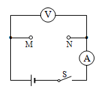

# Physics - 题目 456

**ID**: 321c58ae3b324cd28c76dbac91e1c7e6
**年级**: Grade 9
**难度**: Medium-Hard
**题型**: Experiment

## 题目
某小组同学通过实验探究导体的电阻与哪些因素有关。​​​​​​​‌如图所示，他们在常温下将横截面积、长度不同的铁丝接入电路的MN两点间，利用电流表和电压表测量后计算出阻值，将数据记录在表一、表二中：表一   铁丝实验序号长度l（米）横截面积S（毫米^{2}）电阻R（欧）11.00.20.522.00.21.034.00.22.0表二   铁丝实验序号长度l（米）横截面积S（毫米^{2}）电阻R（欧）42.00.12.052.00.21.062.00.40.5(1)分析比较实验序号可得出的初步结论是：常温下，导体的材料、长度相同，导体的横截面积越大，电阻越小；(2)分析比较实验序号（1、2、3）可得出的初步结论是：常温下，；(3)请进一步综合分析表一、表二的相关数据，并归纳得出结论：①分析比较（1与6）、（2与5）或（3与4）的数据及相关条件，可得出的初步结论是：常温下，；②分析比较（1与6）、（2与5）和（3与4）的数据及相关条件，可得出的初步结论是：常温下，；(4)他们继续分析表一和表二的数据及相关条件，发现无法得到导体的电阻与材料的关系。请你在表三中为他们在添加两组符合要求的材料（填表三），并将所得实验数据与上述两表中实验序号的数据进行比较，进一步探究导体的电阻与材料的关系。表三实验序号材料长度l（米）横截面积S（毫米^{2}）电阻R（欧）78

## 解答

1. (1)[1]分析比较实验序号4、5和6的数据知道，导体的材料、长度相同，且存在的规律是：常温下，导体的横截面积越大，电阻越小。
2. (2)[2]分析比较实验序号（1、2、3）的数据知道，常温下，导体的材料、横截面积相同，导体的长度越大，电阻越大。
3. (3)①[3]分别分析比较（1与6）、（2与5）或（3与4）的数据知道，导体的材料相同，导体的电阻也相同时，导体长度与横截面积的比值相同，故得出的结论是：导体的材料相同，若导体长度与横截面积的比值相同，则导体的电阻相同。
4. ②[4]分析比较（1与6）、（2与5）和（3与4）三组数据及相关条件知道，导体的材料相同，若导体长度与横截面积的比值越大，则导体的电阻越大。
5. (4)[5][6]由于无法得到导体的电阻与材料的关系，所以，需要补充实验材料，结合表三及控制变量法知道，例如补充常见的铝丝和铜丝，且长度相同，横截面积不同，如长度1.0m，横截面积0.2mm^{2}，这样可以与实验序号1的数据进行比较，然后进一步探究导体的电阻与材料的关系。

## 知识点

**中文**:
  - 影响导体电阻大小因素的探究实验

**English**:
  - Experiment: Factors Affecting Resistance

---
