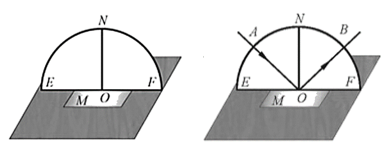

# Physics - 题目 1787

**ID**: 33a6d1ed6f9d46aa9edae212a91b4975
**年级**: Grade 9
**难度**: Medium-Hard
**题型**: Experiment

## 题目
如图甲所示，M是一个水平放置的小镜子，上面竖立着一块半圆形的屏。​​​​​​​‌屏由两个大小相同的扇形面E、F连接而成，E与镜子M固定在一起，F可绕接缝ON转动，接缝ON与镜子M垂直。小明用上述装置探究光的反射规律：(1)他让一束激光沿平面E射到O点，在平面E上可以看到入射光线AO，然后转动平面F，当时，在平面F上可以看到反射光线OB，如图乙所示。则此时（选填“∠AOE”或“∠AON”）是入射角，（选填“∠BON”或“∠BOF”）是反射角；(2)保持激光束在平面E内，多次改变入射光线AO的方向，保证在平面F上都能观察到反射光线OB，用量角器分别测量每次实验时入射角和反射角的大小，比较反射角和入射角的大小，可以得到的实验结论是。

## 解答

1. (1)[1]因为在反射现象中，反射光线和入射光线在同一平面上，所以，只有当E和F在同一平面时，才能在平面F上可以看到反射光线OB。
2. [2]入射角是入射光线与法线的夹角，故∠AON是入射角。
3. [3] 反射角是反射光线与法线的夹角，故∠BON是入射角。
4. (2)[4]反射现象中，反射角和入射角的大小关系是反射角等于入射角。

## 知识点

**中文**:
  - 探究光的反射定律

**English**:
  - Investigation: Law of Reflection

---
