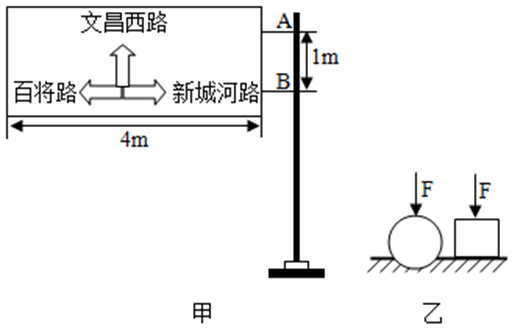

# Physics - 题目 876

**ID**: 388e61ddd8a04f628d94137d695f9d2f
**年级**: Grade 9
**难度**: Medium-Hard
**题型**: Experiment

## 题目
如图甲所示是路边交通指示牌，通过横杆 A、B 与立柱相连，细心的小明发现路边的立柱都是空心圆柱而不是空心方柱。​​​​​​​‌(1)小明猜想可能是空心圆柱比空心方柱的抗压能力强，为此设计了下面的探究活动，如图乙所示，分别在圆纸管和方纸管上面施加压力，观察并记录纸管的形变情况，如下表所示：压力 N类型36912圆纸管完好完好完好完好方纸管完好完好轻度瘪严重瘪在探究过程中，除了要保持纸管的材料、长度、横截面积相同外，还要保持纸管的相同。小明经过多次实验验证了自己的猜想是正确的；(2)图甲中指示牌的总质量是 300kg，长为 4m，高为 2.5m，AB 间距离为 1m。（忽略指示牌与立柱之间的距离，g取 10N/kg）立柱对横杆 B 的作用力的方向是，大小是N。立柱固定在地面上，为了增加立柱的稳定性，最好在立柱底座的（选填“左”或“右”）侧增加固定螺丝；(3)请你写出生活中应用本实验结论的一个实例。

## 解答

1. (1)[1]由控制变量法知道，在探究过程中，除了要保持纸管的材料、长度、横截面积相同外，还要保持纸管的厚度相同。
2. (2)[2][3]指示牌为一杠杆，如下所示，A为支点，指示牌的重心在其几何中心，其重力为动力
3. F_{1}=G
4. 动力臂为
5. $L{{}_{1}}=\frac {4{\rm{m}}}{2}{\rm{=}}2{\rm{m}}$
6. 故阻力为立柱对B施加水平向左的力F_{2}，阻力臂为L_{2}=1m，由杠杆的平衡条件知道
7. $F{{}_{2}}=\frac {F{{}_{1}}L{{}_{1}}}{L{{}_{2}}}=\frac {300{\rm{k}}{\rm{g}}\times 10{\rm{N}}{\rm{/}}{\rm{k}}{\rm{g}}\times 2{\rm{m}}}{1{\rm{m}}}=6000{\rm{N}}$
8. 
9. [4]把立柱看作一杠杆，指示牌对立柱的作用力使其有逆时针转动的趋势，阻力要使其顺时针转动，故立柱固定在地面上，为了增加立柱的稳定性，最好在立柱底座的右侧增加固定螺丝。
10. (3)[5]由于空心圆柱比空心方柱的抗压能力强，所以楼梯的扶手设计成圆筒形的；下水管道也是设计成圆筒形的及拱桥、隧道拱顶、窑洞拱顶等。

## 知识点

**中文**:
  - 探究影响压力作用效果因素的实验

**English**:
  - Experiment: Factors Affecting Pressure Effect

---
