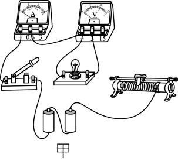
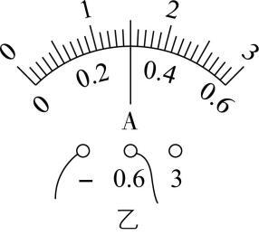
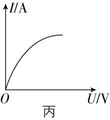
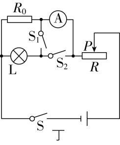

# Physics - 题目 2039

**ID**: 390e9d0031a4460eabc4766ded9c70b0
**年级**: Grade 9
**难度**: Medium-Hard
**题型**: Experiment

## 题目
小红想测量标有“ $1.5\mathrm{V}$ ”字样小灯泡正常发光时的电阻，从实验室找来了电源、电压表、电流表、滑动变阻器、开关和导线若干，进行了如下实验。​​​​​​​‌（1） 用笔画线代替导线，将图甲电路连接完整；（2） 检查无误后，闭合开关，发现电流表无示数，小灯泡不亮，电压表示数接近电源电压。造成这一故障的原因可能是小灯泡（填“断路”或“短路”）；（3） 排除电路故障后，闭合开关，移动滑片，当小灯泡正常发光时，电流表示数如图乙所示，则小灯泡正常发光时的电阻为$\mathrm{\Omega }$  ；接下来她又测量了几组对应的电压值和电流值，并绘制了小灯泡的 $I-U$ 图像，如图丙所示；（4） 小红认为不能利用图甲的装置探究电流与电压的关系，理由是；（5） 小红还想测出另一个额定电压为 ${U}_{额}$ 的小灯泡正常发光时的电阻，在保证电路安全的前提下，设计了如图丁所示的电路（电源电压恒定、大于 ${U}_{额}$ 且未知，滑动变阻器 $R$ 最大阻值未知，定值电阻阻值为 ${R}_{0}$ ）。请将实验步骤补充完整：①闭合 $\mathrm{S}$ 、 ${\mathrm{S}}_{2}$ ，断开 ${\mathrm{S}}_{1}$ ，移动滑片 $P$ ，使电流表示数为时，小灯泡正常发光；②闭合 $\mathrm{S}$ 、 ${\mathrm{S}}_{1}$ ，断开 ${\mathrm{S}}_{2}$ ，保持滑片 $P$ 位置不变，读出电流表的示数为 $I$ ；③小灯泡正常发光时的电阻 ${R}_{\mathrm{L}}=$（用 ${U}_{额}$ 、 $I$ 、 ${R}_{0}$ 表示）。

## 解答

1. （1） 实验中通过调节滑动变阻器的滑片，改变灯泡两端的电压，所以滑动变阻器与灯泡串联，滑动变阻器按照“一上一下”的接法连入电路。
2. （2） 电流表无示数，灯泡不亮，说明电路存在断路，电压表示数接近电源电压，说明与电压表并联部分以外的电路是通路，故造成这一现象的原因可能是小灯泡断路。
3. （3） 由题图乙可知，电流表选用 $0\sim 0.6\mathrm{A}$ 量程，分度值为 $0.02\mathrm{A}$ ，示数为 $0.3\mathrm{A}$ ，则小灯泡正常发光时通过小灯泡的电流为 $0.3\mathrm{A}$ ，则小灯泡正常发光时的电阻为 $R\prime =\frac{{U}_{\mathrm{L}}}{{I}_{\mathrm{L}}}=\frac{1.5\mathrm{V}}{0.3\mathrm{A}}=5\mathrm{\Omega }$  。
4. （4） 探究电流与电压的关系时，需要控制与电压表并联的电阻的阻值不变，根据题图丙可知，小灯泡灯丝的电阻随温度的变化而变化，所以不能完成该实验探究。
5. （5） ①闭合 $\mathrm{S}$ 、 ${\mathrm{S}}_{2}$ ，断开 ${\mathrm{S}}_{1}$ ，此时定值电阻与灯泡并联后再与滑动变阻器 $R$ 串联，电流表测量通过定值电阻的电流，为了使灯泡正常发光，灯泡两端电压应达到 ${U}_{额}$ ，由于定值电阻与灯泡并联，定值电阻两端电压等于灯泡两端电压，所以通过定值电阻的电流为 $\frac{{U}_{额}}{{R}_{0}}$ 时，灯泡正常发光；②闭合 $\mathrm{S}$ 、 ${\mathrm{S}}_{1}$ ，断开 ${\mathrm{S}}_{2}$ ，此时定值电阻与灯泡并联后再与滑动变阻器 $R$ 串联，电流表测量干路中的电流，保持滑片 $P$ 位置不变，灯泡仍正常发光，读出电流表的示数为 $I$ ，则通过灯泡的电流 ${I}_{灯}=I-\frac{{U}_{额}}{{R}_{0}}$ ；③小灯泡正常发光时的电阻 ${R}_{\mathrm{L}}=\frac{{U}_{额}}{{I}_{灯}}=\frac{{U}_{额}}{I-\frac{{U}_{额}}{{R}_{0}}}=\frac{{U}_{额}{R}_{0}}{I{R}_{0}-{U}_{额}}$ 。

## 知识点

**中文**:
  - 伏安法测电阻的探究实验
  - 其他方法测电阻

**English**:
  - Experiment: Measuring Resistance (Voltammetry)
  - Other Methods for Measuring Resistance

---
