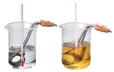

# Physics - 题目 2611

**ID**: 39c93d2cd87d40069187093307f4aa61
**年级**: Grade 9
**难度**: Medium-Hard
**题型**: Experiment

## 题目
在探究“比较不同物质吸热的情况”的实验中，实验装置如图所示。​​​​​​​‌（1）实验应量取（填“质量”或“体积”）相同的甲、乙两种液体，分别倒入相同的烧杯中。使用规格（填“相同”或“不同”）的电加热器加热；（2）实验中，通过（填“升高的温度”或“加热时间”）来比较甲和乙两种液体吸收热量的多少；（3）在两种液体都不沸腾的前提下，小明认为要把甲、乙两种液体加热到相同的温度然后进行比较；小芳认为要加热相同的时间然后进行比较。你认为方法可行的是（填“小明”、“小芳”或“都可行”）；加热时间/min01234甲的温度/℃3034384246乙的温度/℃1018263442（4）分析上表数据得（填“甲”或“乙”）物质的吸热能力强，要在甲、乙两种液体中选择一种液体做冷却液，你认为选择（填“甲”或“乙”）液体较为合理；（5）物理学中用表示物质的吸热能力。

## 解答

1. （1）[1]探究物质吸热能力实验时，应量取质量相同的两种液体，分别倒入相同的烧杯中。
2. [2]使用规格相同的电加热器加热，液体在相等时间内吸收的热量相等，更方便比较不同物质吸热的情况。
3. （2）[3]用相同的电加热器加热，加热相同的时间，放出的热量就是相等的，甲和乙吸收的热量也就是相等的，所以物质吸热的多少是通过加热时间来反映。
4. （3）[4]比较甲、乙两种液体吸热本领的大小，可以加热相同的时间，观察两种液体温度的变化量，温度变化量越大说明吸热能力弱；也可以加热到相同的温度，比较加热时间的长短，加热时间长的吸热能力强，因此这两种方法都可以比较出液体的吸热能力。
5. （4）[5]由表格中的数据可知，在相同的时间内，吸收相同的热量，甲的温度变化小，乙的温度变化大，则甲的吸热能力强。
6. [6]根据 $Q{{}_{吸}}=cm\Delta t$ ，吸收相同的热量，比热容大的，温度升高的就小，就更适合做冷却液，甲的吸热能力强，甲的比热容大，故甲做冷却液更好。
7. （5）[7]物理学中用比热容来表示物质吸热能力的强弱。

## 知识点

**中文**:
  - 物质的比热容探究实验

**English**:
  - Experiment: Investigating Specific Heat Capacity

---
