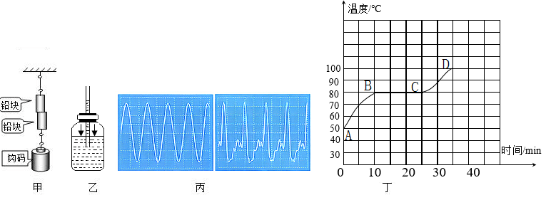

# Physics - 题目 311

**ID**: 3ab059c442c94633bd90fd55e264d0e6
**年级**: Grade 9
**难度**: Medium-Hard
**题型**: Experiment

## 题目
根据如图中的实验示意图，在下面的空格处填入相应的内容。​​​​​​​‌(1)甲图，两个铅柱没有被重物拉开，主要是因为铅柱的；(2)乙图，把玻璃瓶从山下拿到山上，管内水柱的高度会；(3)丙图，观察两种乐器发出的C调I（do）的波形图，说明声音的不同；(4)丁图，该物质在B点时的内能它在C点时的内能（选填“>”，“＜”或“=”），该物质在AB段比CD段温度变化快的原因可能是。

## 解答

1. (1)[1]组成物质的分子间存在相互作用的引力，两块表面干净的光滑铝块压紧后，它们会结合在一起，并能在下面吊起一个砝码，证明了物体的分子间有引力。
2. (2)[2]把玻璃瓶从山下拿到山上，大气压降低，管内水柱的高度会上升。
3. (3)[3]观察两种乐器发出的C调I（do）的波形图，波形图中两者的振幅相同，所以声音响度相同；完成一次振动所需的时间相同（都是两个格）即频率相同，所以音调相同；但在每次振动中，波的形状不同，即音色不同。说明不同的乐器，音色不同。
4. (4)[4][5]如图丁该物质从B点到C点吸收热量，故内能增加；烧杯内物质在相同时间内吸收的热量相同，在OA时间里升高的温度为 $Δt{{}_{1}}=10℃$ ，用时间为5min，在CD时间里升高的温度为△t_{2}=10℃，用时间为10min，由 $Q=cmΔt$ 可知，当质量和升高温度都相同时，固体吸收的热量是液态吸收热量的 $\frac {1}{2}$ ，所以固态时的比热容是液态时的 $\frac {1}{2}$ ，故物质在AB段温度变化比CD段快。

## 知识点

**中文**:
  - 分子间的作用力
  - 用波形比较音色
  - 大气压强与高度的关系
  - 比热容的概念及其计算

**English**:
  - Intermolecular Forces
  - Comparing Timbre using Waveforms
  - Relationship between Atmospheric Pressure and Altitude
  - Concept and Calculation of Specific Heat Capacity

---
