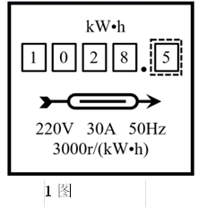
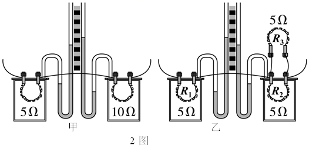

# Physics - 题目 2248

**ID**: 3d93908e3ad0413e8020ab77ce383f63
**年级**: Grade 9
**难度**: Medium-Hard
**题型**: Experiment

## 题目
（1）小珠家的电能表如1图所示，它的读数为kW•h，此电能表允许连接用电器的最大总功率为W。​​​​​​​‌为测量某电暖器的实际功率，小珠将电暖器单独接入自家电路中，观察电能表，表盘在1min内转动了60r，则该电暖器的实际功率是W。（2）小海同学在探究“电流通过导体产生热的多少与什么因素有关”时，采用如2图所示的实验装置，请观察甲、乙两图并回答下列问题：①实验中，通过观察U形管中液面的变化，来比较电流通过电阻丝产生热量的多少。②甲装置是用来研究通电时间相同时，电阻丝产生的热量与的关系。③用乙装置进行实验时，电阻R_{3}的作用是使通过R_{1}、R_{2}的电流（选填“相同”或“不相同”）。④当家庭电路中的导线连接处接触不良时，该处电阻会增大，容易引发火灾。则图（选填“甲”或“乙”）的实验结论可以用来解释这种现象。

## 解答

1. (1)[1]电能表表盘显示10285，由于最后一位是小数位，单位是kW•h，读数是1028.5kW•h；
2. [2]30A表示电能表平时工作允许通过的最大电流，小珠家电能表后面可以连接的用电器的总功率：
3. $P{{}_{最大}}=UI{{}_{最大}}=220{\rm V}\times 30{\rm A}=6600{\rm W}$ ；
4. [3]3000r/（kW•h）表示电能表的转盘每转1圈，电路中用电器消耗 $\frac {1}{3000}{\rm{k}}{\rm{W}}\cdot {\rm{h}}$ 的电能，电能表的转盘转60圈，电暖器消耗电能为：
5. $W\prime =60\times \frac {1}{3000}{\rm{k}}{\rm{W}}\cdot {\rm{h}}=0.02{\rm{k}}{\rm{W}}\cdot {\rm{h}}$ ，
6. 用电时间
7. $t=1{\rm \min }=\frac {1}{60}{\rm h}$ ，
8. 电暖器的实际功率：
9. $P=\frac {W}{t}=\frac {0.02{\rm{k}}{\rm{W}}\cdot {\rm{h}}}{\frac {1}{60}{\rm h}}=1.2{\rm {\rm kW}}=1200{\rm W}$ 。
10. (2) ①[4]电流通过导体产生热量的多少不能直接观察，但液体温度的变化可以通过液面高度差的变化来反映，这种研究方法叫转换法；
11. ②[5] 将容器中的电阻丝串联起来接到电源两端，通过它们的电流I与通电时间t相同，左边容器中的电阻小于右边容器中的电阻，由 $Q=I{^{2}}Rt$ 可知，右边容器中的电阻产生的热量多，温度升得较快，这表明：在相同时间内，电流相同的情况下，电阻越大，电流通过导体时产生的热量越多；
12. ③[6] 图乙的装置在实验中，右侧容器的外部，将一个完全相同的电阻R_{3}和这个容器内的电阻R_{2}并联，再接入原电路，使通过左边容器中电阻R_{1}的电流与通过右边容器中电阻R_{2}的电流不相等；
13. ④[7] 当家庭电路中的导线连接处接触不良时，容易引发火灾。其原因是由于导线相互连接处因接触不良，该处的电阻较大，串联在电路中，通过导体的电流相等、通电时间相等，根据 $Q=I{^{2}}Rt$ ，连接处产生的热量较多，因此可以用甲中的实验结论来解释这种现象。

## 知识点

**中文**:
  - 影响电流热效应因素的探究实验
  - 电能表的读数及电能的求解
  - 电功率的计算及应用

**English**:
  - Experiment: Factors Affecting Heating Effect
  - Reading Energy Meters and Calculating Energy
  - Calculation and Application of Electric Power

---
