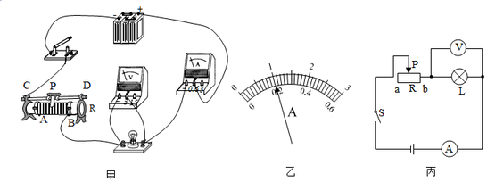

# Physics - 题目 1067

**ID**: 3f2a1e151cad49b09e9df8fd224f226f
**年级**: Grade 9
**难度**: Medium-Hard
**题型**: Experiment

## 题目
某实验小组的同学用图甲所示器材测量小灯泡电功率，待测小灯泡L的额定电压为3.8V，额定功率小于1W，电源电压恒为6V，滑动变阻器R的规格为“20Ω 1A”。​​​​​​​‌（1）正确连接完电路，闭合开关后，发现无论怎样移动滑片，小灯泡不亮，电流表无示数，电压表示数明显，仔细检查，连接无误，那么出现该状况的原因应该是；（2）排除故障后，通过正确操作，当灯泡正常发光时，电流表示数如图乙所示，据此计算出小灯泡的额定功率为W；（3）测出小灯泡的额定功率后，再测大于小灯泡额定功率的实际功率，应将滑动变阻器的滑片向（选填“左”或“右”）端滑动；（4）测量小灯泡的电功率（选填“需要”或“不需要”）多次测量求平均值，原因是；（5）图丙是该实验小组的同学测量小灯泡电功率的电路图，测量后他们对测量结果进行了误差分析，考虑电表本身对电路的影响，该电路主要是由于所测（选填“电压”或“电流”）值偏大引起小灯泡电功率偏大的。

## 解答

1. （1）正确连接完电路，闭合开关后，发现无论怎样移动滑片，小灯泡不亮，电流表无示数，电路可能断路，电压表示数明显，则电压表与电源连通，仔细检查，连接无误，那么出现该状况的原因应该是灯泡处断路。
2. （2）排除故障后，通过正确操作，当灯泡正常发光时，电流表示数如图乙所示，电流表选用小量程，分度值为0.02A，其示数为0.2A，小灯泡的额定功率为
3. P_{L}=U_{L}I_{L}=3.8V×0.2A=0.76W
4. （3）测出小灯泡的额定功率后，再测大于小灯泡额定功率的实际功率，应增大灯的电压，由串联电路的规律，要减小变阻器的电压，由分压原理，将滑动变阻器的滑片向右端滑动。
5. （4）测量小灯泡的电功率不需要多次测量求平均值，原因是灯在不同电压下的功率不同。
6. （5）图丙中，电压表与灯并联，电压表测量的电压是准确的，电流表测灯与电压表并联的总电流，由并联电路电流的规律，电流表示数大于灯的实际电流，即该电路主要是由于所测电流值偏大，从而引起小灯泡电功率也会偏大。

## 知识点

**中文**:
  - 串、并联电路中短路和断路的分析
  - 并联电路的电流规律
  - 串联电路的电压规律
  - 电功率的计算及应用
  - 额定电压与额定功率

**English**:
  - Analysis of Short and Open Circuits
  - Current Law in Parallel Circuits
  - Voltage Law in Series Circuits
  - Calculation and Application of Electric Power
  - Rated Voltage and Rated Power

---
