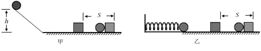

# Physics - 题目 565

**ID**: 3f539dca7cb74f03bd9fc5ab77f0b1d2
**年级**: Grade 9
**难度**: Medium-Hard
**题型**: Experiment

## 题目
在探究“物体动能大小与哪些因素有关”的实验中，小明让质量不同的小球从同一斜面的同一高度由静止释放，撞击同一木块，木块被撞出一段距离，如图甲所示。​​​​​​​‌(1)将小球从同一高度由静止释放的目的是。该实验的目的是研究小球的动能大小与（质量/速度）的关系；(2)该实验是通过观察来反映小球的动能大小；(3)小明还想通过上述实验过程探究物体重力势能与质量的关系，小明的设想（可行/不可行），理由；(4)有同学将实验装置改进成图乙所示，用同一小球将同一弹簧压缩不同程度后静止释放，撞击同一木块，将木块撞出一段距离进行比较，可以研究小球的动能大小与（质量/速度）的关系；(5)该同学还想用质量不同的小球将同一弹簧压缩相同程度后由静止释放，撞击同一木块，探究小球的动能大小与质量的关系。这个设计方案（可行/不可行），如果按此方案操作，可以观察到的现象是。

## 解答

1. (1)[1]将小球从同一高度由静止释放，重力势能转化为动能，到达水平面时，速度大小相同，所以目的是控制小球到达水平面时速度大小相等。
2. [2]既然速度大小相等，那么这是球的动能大小与质量的关系。
3. (2)[3]木块移动的距离越大，证明球的动能越大，所以该实验是通过观察木块移动的距离来反映小球的动能大小。
4. (3)[4][5]小明还想通过上述实验过程探究物体重力势能与质量的关系，小明的设想可行，因为质量大小是可以知道的，同时通过对比木块移动的距离大小来得知动能大小，而动能是由重力势能转化过来的，那么可知重力势能大小，那么可探究物体重力势能与质量的关系。
5. (4)[6]同一小球质量相同，同一弹簧压缩不同程度后静止释放，那么弹性势能不同，小球的速度不同，压缩程度大速度大，转化的动能大小不同，通过木块移动的距离大小来得知动能大小，这时可以研究小球的动能大小与速度关系。
6. (5)[7][8]这个方案不可行，因为同一弹簧压缩相同程度，弹性势能相同，由静止释放，转化的动能相同，撞击同一木块，移动的距离相等，小球的质量不同，但是动能相同，不能探究小球的动能大小与质量的关系。

## 知识点

**中文**:
  - 探究影响物体动能大小因素的实验

**English**:
  - Experiment: Factors Affecting Kinetic Energy

---
