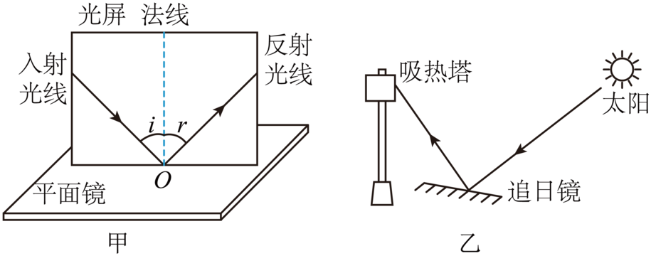

# Physics - 题目 1364

**ID**: 40bdd1c6e2dd4d2a849b1e883e00af43
**年级**: Grade 9
**难度**: Medium-Hard
**题型**: Experiment

## 题目
探究光的反射定律，实验装置如图甲。​​​​​​​‌让一束光贴着光屏射向平面镜的O点，改变入射光线多次实验，数据记录于表中。实验序号入射光线相对法线的位置反射光线相对法线的位置∠i∠r1左右30°30°2左右45°45°3左右60°60°4右左60°60°（1）图甲中，入射角是∠；我们能从不同方向观察到光的传播路径，是因为光在光屏上发生反射；改变光束入射的角度时，观察到反射光的方向（选填“发生”或“没有”）改变。（2）分析表中数据得出结论：①反射光线、入射光线分别位于法线；②反射角入射角。比较序号为的实验可知，在光的反射现象中，光路可逆。（3）光热电站利用追日镜将太阳光反射到吸热塔用于发电。如图乙为上午某时刻的光路图，根据上述实验结论推断，随着太阳的运动，追日镜应沿时针方向旋转，使反射光线射向吸热塔。

## 解答

1. （1）入射角是入射光线与法线的夹角，故∠i是入射角。
2. 能从不同方向观察到光的传播路径是因为光屏上发生的是漫反射，反射光线射向四面八方。
3. 改变光束入射的角度时，入射角发生变化，反射角等于入射角，故观察到反射光的方向发生改变。
4. （2）分析表中数据可知，入射光线相对法线的位置在左，反射光线相对法线的位置在右，故得出反射光线、入射光线分别位于法线两侧。
5. ②根据表中数据可知30°=30°，45°=45°， 60°=60°
6. 故得出反射角等于入射角。
7. 比较序号为3、4的实验可知，让光线逆着反射光线射向镜面时，经平面镜反射后，反射光线逆着原入射光线方向射出，表明在光的反射现象中，光路可逆。
8. （3）根据图乙可知，此时上午某时刻的光路图，说明太阳要逆时针方向运动（向西运动），入射角变小，反射角也要变小，则为了保证使反射光线射向吸热塔，追日镜也要沿逆时针方向旋转，使反射光线射向吸热塔。

## 知识点

**中文**:
  - 探究光的反射定律

**English**:
  - Investigation: Law of Reflection

---
