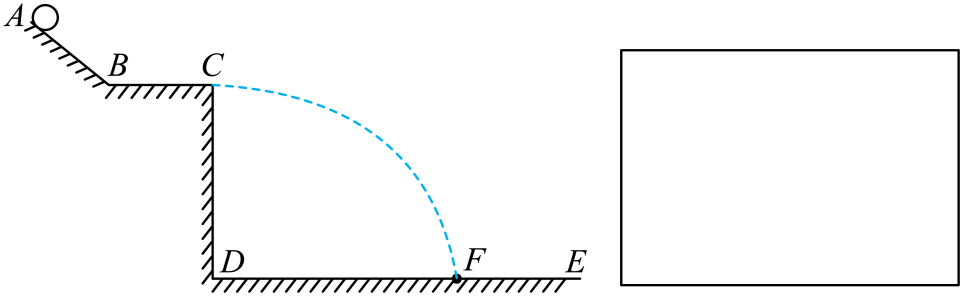

# Physics - 题目 2087

**ID**: 4544e1f2acbb461584275df9734d0976
**年级**: Grade 9
**难度**: Medium-Hard
**题型**: Experiment

## 题目
小明是一个滑雪爱好者，在某次跳台滑雪过程中，小明在平台上以一定的初速度向平台边缘滑去并飞出，着陆于平面上。​​​​​​​‌为了研究这一过程，小明准备了一个简单的轨道模型、刻度尺和几个相同材质但不同质量的小球。如图所示，小球从A点下滑后到达B点，经过水平面BC后飞出并着落于DE水平面上的F点。（1）以圆点代表小球，请在方框中画出小球在BC段的受力示意图。（2）为了探究小球落地DF段的距离与小球质量的关系，小明分别用不同质量的小球从A点由静止下滑，并且用刻度尺测量DF段的距离。让小球从同一点静止滑下的目的是：。（3）小明完成实验后，提出新的猜想，小球从C点飞出到落地F点的时间可能与小球在C点的初速度有关。请你补充合适的器材，设计一个实验方案，帮助小明探究此猜想是否正确。

## 解答

1. （1）对小球进行受力分析可知，小球在平面BC上运动时，受到重力、平面对小球的支持力与平面对小球的摩擦力的作用，如下图所示：
2. 
3. （2）根据控制变量法的原则可知，想探究小球落地DF段的距离与小球质量的关系，需保证从C点离开时的速度相同，只改变小球的质量，而使不同质量的小球从斜面上的同一点由静止释放可以使小球C点离开时的速度相同。
4. （3）探究小球从C点飞出到落地F点的时间与小球在C点的初速度的关系时，要保证小球的质量不变，改变到达C点时的速度，所以进行实验时应当用同一个小球从斜面的不同高度处释放，用秒表测量小球从C点飞出到落地的时间，比较不同高度时对应的时间，如果时间相同，说明小球从C点飞出到落地F点的时间与小球在C点的初速度无关，如果时间不同，说明小球从C点飞出到落地F点的时间与小球在C点的初速度有关。

## 知识点

**中文**:
  - 力的示意图与图示
  - 科学探究过程及实验方法

**English**:
  - Force Diagrams
  - Scientific Inquiry Process and Experimental Methods

---
