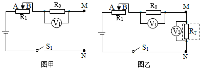
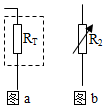

# Physics - 题目 191

**ID**: 46b53448a81547a997662e8afe030bb4
**年级**: Grade 9
**难度**: Medium-Hard
**题型**: Experiment

## 题目
某实验小组想要探究某热敏电阻的阻值和温度的关系，已接入电路中的器材有∶电源、电压表V_{2}、阻值为R_{0}的定值电阻、滑动变阻器R_{1}、单刀开关S_{1}，如图甲所示∶置于温控室（图中虚线区域，温度可调且自动显示）中的热敏电阻R_{T}暂未接入电路，符号如图a所示。​​​​​​​‌可供选择的器材有∶电压表V_{2}、电阻箱R_{2}（阻值可以直接读出的变阻器），符号如图b所示单刀开关2只，导线若干。(1)小明同学选择电压表V_{2}与热敏电阻R_{T}按图乙所示接入MN之间。在闭合S_{1}前，图乙中R_{1}的滑片应移动到（填“A”或“B”）端；当温控室的温度为t_{1}时，两电压表示数分别为U_{1}、U_{2}，则此时热敏电阻的阻值R_{T}=（用已知量和测量值表示）。(2)小惠同学没有选择电压表V_{2}，而是选择了电阻箱R_{2}，请你在图甲中帮她完善电路图。(3)在小惠设计的实验中，热敏电阻的阻值R_{T}，满足的关系式为。

## 解答

1. (1)[1]在闭合S_{1}前，图乙中R_{1}的滑片应移动到阻值最大处的B端。
2. [2]R_{0}和R_{T}串联，当温控室的温度为t_{1}时，两电压表示数分别为U_{1}、U_{2}，根据分压原理可知
3. $\frac {U{{}_{1}}}{U{{}_{2}}}=\frac {R{{}_{0}}}{R{{}_{{\rm{T}}}}}$
4. 则此时热敏电阻的阻值
5. $R{{}_{{\rm{T}}}}=\frac {U{{}_{2}}R{{}_{0}}}{U{{}_{1}}}$
6. (2)[3]小惠同学没有选择电压表V_{2}，而是选择了电阻箱R_{2}，先将热敏电阻接入电路中，通过开关的转换，再将电阻箱接入电路中，通过改变电阻箱的电阻，控制电压表示数不变，根据等效替代法可求出热敏电阻阻值，电路图如图所示
7. 。
8. (3)[4]小惠选择的是等效替代法，所以在小惠设计的实验中，热敏电阻的阻值R_{T}，满足的关系式为R_{T}=R_{2}。
9. 故选C。
10. (4)[5]根据得出的热敏电阻的阻值随温度变化的规律可知，随温度的升高，热敏电阻阻值变小。

## 知识点

**中文**:
  - 导体的电阻受温度的影响
  - 影响导体电阻大小因素的探究实验

**English**:
  - Effect of Temperature on Resistance
  - Experiment: Factors Affecting Resistance

---
