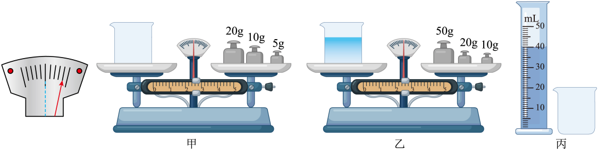

# Physics - 题目 2010

**ID**: 48e6e122b6d14d0ba8e17b2157080d26
**年级**: Grade 9
**难度**: Medium-Hard
**题型**: Experiment

## 题目
学习密度知识后，小海同学想测量家里酱油的密度。​​​​​​​‌他的操作如下：（1）将天平放在水平桌面后，先将，若发现指针在分度盘中央两侧摆动幅度如图所示，接下来应向调节平衡螺母；（2）如图所示甲、乙、丙图是他按顺序进行实验的示意图；根据图中的数据，可计算出酱油的密度是kg/m³；（3）在以上实验中，烧杯壁会残留部分酱油而导致实验结果（选填“偏大”或“偏小”），应该是怎样的顺序才能减小实验误差（填选项字母）；

## 解答

1. （1）使用天平时，将天平放在水平桌面后，先将游码拨到标尺的零刻度线；由图知道，指针摆动的幅度向右大，说明右侧质量稍大，因此，应将平衡螺母向左调节，直至指针指向分度盘中央。
2. （2）由图甲知道，空杯的质量为20g+10g+5g+2.4g=37.4g，由图乙知道，烧杯与油的总质量为50g+20g+10g+2.4g=82.4g，则油的质量m=82.4g-37.4g=45g，由图丙知道，量筒的分度值为2mL，则油的体积V=40mL=40cm^{3}，油的密度 $ρ=\frac {m}{V}=\frac {{{4}}{{5}}{\rm{g}}}{{{4}}{{0}}{\rm{c}}{\rm{m}}{^{{{3}}}}}=1.125{\rm{g}}{\rm{/}}{\rm{c}}{\rm{m}}{^{3}}=1.125\times 10{^{3}}{\rm{k}}{\rm{g}}{\rm{/}}{\rm{m}}{^{3}}$
3. （3）因为烧杯壁会残留部分酱油，所以酱油的体积减小了，根据密度公式，质量不变，体积减小，密度值就增大了，所以结果偏大；为防止容器壁粘液体影响所测结果，要先测烧杯、酱油总质量，再将酱油倒入量筒测体积，并测倒走酱油后烧杯的质量。这样就避免了误差的产生，即按照乙、丙、甲实验顺序，故C符合题意，ABD不符合题意。
4. （4）①用细线系住金属块，用弹簧测力计测出金属块在空气中的重力G=F_{1}；
5. ②把小金属块浸没入水中，测出此时拉力为F_{2}；金属块受到的浮力 $F{{}_{浮}}=F{{}_{1}}-F{{}_{2}}=ρ{{}_{水}}Vg$
6. 所以，金属块的体积 $V=\frac {F{{}_{1}}-F{{}_{2}}}{ρ{{}_{水}}g}$
7. ③用弹簧测力计拉住石块，使其浸没在适量的待测液体中，测得拉力为F_{3}；因为金属块浸没液体中，所以金属块排开酱油的体积 $V{{}_{排}}=V=\frac {F{{}_{1}}-F{{}_{2}}}{ρ{{}_{水}}g}$ ，金属块受到的浮力 $F{{}_{浮}}{^{\prime }}=F{{}_{1}}-F{{}_{3}}=ρ{{}_{酱油}}V{{}_{排}}g$ ，解得酱油密度 $ρ{{}_{酱油}}=\frac {\left ({F{{}_{1}}-F{{}_{3}}}\right )ρ{{}_{水}}}{F{{}_{1}}-F{{}_{2}}}$

## 知识点

**中文**:
  - 利用浮力知识测密度
  - 液体密度的测量实验

**English**:
  - Measuring Density using Buoyancy
  - Experiment: Measuring Density of Liquids

---
