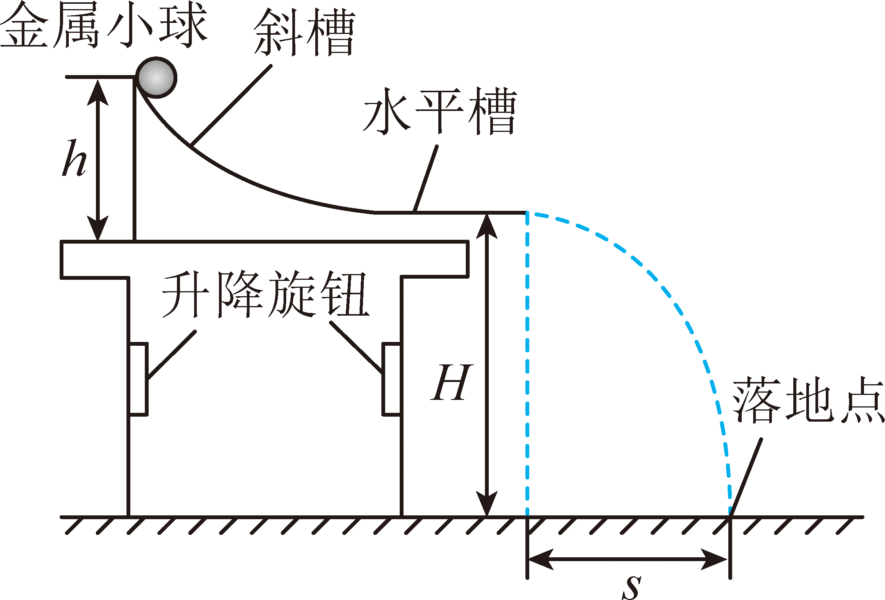

# Physics - 题目 2805

**ID**: 495232e66cfb4dbc8079e9964c3879da
**年级**: Grade 9
**难度**: Medium-Hard
**题型**: Experiment

## 题目
小明在玩“水枪”玩具时，发现当“水枪”水平放置时，推动活塞的速度越快，水枪离地面的高度越高，水就会射得越远。​​​​​​​‌“空中水平抛出物体的落地水平距离与哪些因素有关呢？”他提出了如下猜想：猜想1：与空中水平抛出物体的初速度有关；猜想2：与空中水平抛出物体离地面的高度有关；为验证猜想，小明和同学设计了如图所示的实验装置。（1）为便于实验数据的采集，落地点的材料应选用（选填“光滑木板”“橡皮泥”或“毛巾”）（2）让金属小球从斜槽上由静止释放，小球的能转化为小球的动能，实验中控制小球到达水平槽时速度的方法是，通过调节升降旋钮，可控制的猜想因素；（3）下表是小明在实验中测得的数据：实验序号抛出点离地面的高度H/m小球在斜槽上由静止释放时的高度h/m落地点与抛出点的水平距离s/m落地点与抛出点的水平距离的平方 $s{^{2}}$ / ${\rm{m}}{^{{{2}}}}$10.50.10.450.220.50.20.60.430.50.30.780.641.00.10.630.451.00.20.890.861.00.31.101.2①分析实验序号的数据，可知猜想1是正确的；②综合分析表中所给数据，请你写出 $s{^{2}}$ 与h、H之间的关系式： $s{^{2}}=$；（4）小华猜想“空中水平抛出物体的质量越大，落地水平距离越大”。他选择了乒乓球和几个质量不同的金属小球，让它们均从斜槽的同一位置由静止释放，发现所有金属小球落地点的水平距离s几乎相同，但乒乓球落地点的水平距离s总是较小。你认为小华的猜想是的。（选填“正确”或“错误”）

## 解答

1. （1）落地点的材料应该选择容易发生形变且现象明显的物质，所以选择的是橡皮泥。
2. （2）金属小球从斜槽上由静止释放，小球质量不变，高度变小，速度变大，所以是重力势能转化为动能。
3. 小球从斜槽相同高度由静止释放可以控制小球到达水平面时的初速度相同。
4. 调节升降旋钮，可以调整物体离地面的高度，即可以控制水平抛出物体离地面的高度。
5. （3）猜想1认为，空中水平抛出物体的落地水平距离与空中水平抛出物体的初速度有关，所以要改变空中水平抛出物体的初速度，由表中数据可知，实验1、2、3或4、5、6中，抛出点离地面的高度相同，小球在斜槽上由静止释放时的高度逐渐变大，即空中水平抛出物体的初速度逐渐变大，落地点与抛出点的水平距离逐渐变大，故可知猜想1是正确的。
6. 由表中数据可知，每组实验中抛出点离地面的高度与小球在斜槽上由静止释放时的高度乘积的4倍等于落地点与抛出点的水平距离的平方，故
7. $s{^{2}}=4Hh$
8. （4）使用乒乓球和几个质量不同的金属小球，让它们均从斜槽的同一位置由静止释放，发现所有金属小球落地点的水平距离s几乎相同，说明落地水平距离与小球的质量无关，所以他的猜想是错误的。

## 知识点

**中文**:
  - 科学探究过程及实验方法

**English**:
  - Scientific Inquiry Process and Experimental Methods

---
