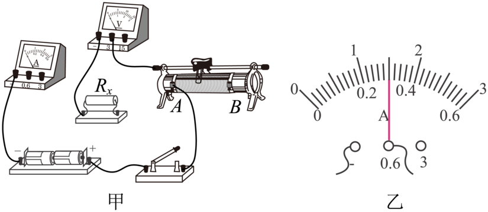

# Physics - 题目 1670

**ID**: 4c96f0b9d4664c838190f428f3598c38
**年级**: Grade 9
**难度**: Medium-Hard
**题型**: Experiment

## 题目
如图所示，在“伏安法测电阻”的实验中，电源为两节新干电池，滑动变阻器标有“20Ω，1A”的字样。​​​​​​​‌（1）请用笔画线表示导线将图甲的实物连接成完整电路；（2）连接电路时开关应该。正确连接电路，闭合开关前，应将滑动变阻器的滑片移至端（选填“A”或“B”）；（3）闭合开关后，发现电流表无示数，电压表有明显偏转，移动变阻器的滑片，电流表、电压表指针均无变化，则故障可能是定值电阻R_{x}（选填“短路”或“断路”）；（4）排除故障后，调节变阻器使电压表的示数为1.5V时，电流表示数如图乙所示为A，所测电阻的阻值为Ω。为了使结果更准确，接下来应该进行的操作是：；（5）实验结束进行交流时，某同学提出调节变阻器时，电压表示数始终无法调到0.5V，请你提出一个解决的办法：。

## 解答

1. （1）由图乙知，电流表选用小量程，将电流表与滑动变阻器、电阻串联接入电路，电压表接在定值电阻两端，如图
2. 
3. （2）连接电路时，为保护电路，开关应该处于断开状态，闭合开关前，滑动变阻器的滑片应该移到阻值最大处，即B端。
4. （3）闭合开关后，电流表无示数，说明电路存在断路；电压表指针有明显偏转，移动变阻器的滑片，电流表、电压表指针均无变化，说明电压表串联在电路中，则故障可能是定值电阻R_{x}断路。
5. （4）由图可知电流表接入电路的量程为 $0\sim 0.6{\rm{A}}$ ，分度值为0.02A，示数为0.3A；电压表的示数为1.5V时，由欧姆定律可得所测电阻的电阻 $R=\frac {U}{I}=\frac {1.5{\rm{V}}}{0.3{\rm{A}}}=5Ω$
6. |为了使结果更准确，接下来应该进行的操作是：调节滑动变阻器，测得多组电流值和电压值，计算出电阻值，再求平均值。
7. （5）由电路图可知，定值电阻与滑动变阻器串联，根据串联电路的分压原理知，换用最大阻值更大的滑动变阻器，可以增大滑动变阻器的最大分压，减小定值电阻两端的电压，使电压表示数始终无法调到0.5V。

## 知识点

**中文**:
  - 伏安法测电阻的探究实验

**English**:
  - Experiment: Measuring Resistance (Voltammetry)

---
