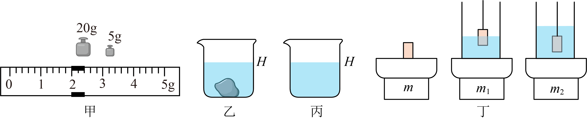

# Physics - 题目 2938

**ID**: 4f22f72aaf364776b154a947d94afd04
**年级**: Grade 9
**难度**: Medium-Hard
**题型**: Experiment

## 题目
如图是小红测量液体密度的实验装置。​​​​​​​‌（1）将天平放在工作台上，调节天平平衡后才发现游码未归零，将游码重新归零后，应将平衡螺母向（选填“左”或“右”）调节，才能使天平再次平衡；（2）调好天平后，小红利用石块（石块不吸水）测量未知液体的密度，石块密度为2.7g/cm^{3}；①将石块放在天平的左盘，向右盘中加减砝码并移动游码后，天平再次平衡，右盘砝码和游码如图甲所示，石块的质量为g；②如图乙所示，将石块轻轻放人装有适量液体的烧杯中，再用天平称量m_{乙}=90g。在液面处标记H；③将石块取出，添加该液体至标记H处，用天平测得质量为m_{丙}=81g，如图丙所示：则该液体的密度为kg/m^{3}。石块取出时会沾有液体，这会使所测液体密度（选填“偏大”“偏小”或“无影响”）；[拓展]（3）小红还想用台秤、烧杯和细线，测量未知圆柱体金属块的密度，测量步骤如图丁所示（细线体积忽略不计）：①用台秤测出圆柱体金属块的质量为m；②将圆柱体金属块一半没入水中。记下台秤的示数为m_{1}。将其全部没人水中，记下台秤的示数为m_{2}；③则圆柱体金属块的密度 $ρ{\rm =}$（用m、m_{1}、m_{2}、 $ρ$_{水}四个物理量表示）。

## 解答

1. （1）为了减小测量误差，天平在使用前，应先放置在水平桌面上。
2. 调节天平平衡后才发现游码未归零，将游码重新归零后，天平左侧托盘会下降，为使天平在水平位置平衡，平衡螺母应向右调节。
3. （2）甲图中天平标尺的分度值是0.2g，石块的质量为 $20{\rm{g}}+5{\rm{g}}+2{\rm{g}}=27{\rm{g}}$
4. 已知石块密度为2.7g/cm^{3}，则石块的体积为 $V{{}_{石块}}=\frac {m{{}_{石块}}}{ρ{{}_{石块}}}=\frac {27{\rm{g}}}{2.7{\rm{g}}/cm{^{3}}}=10cm{^{3}}$
5. 烧杯中液体的质量为 $m{{}_{液}}=90{\rm{g}}-27{\rm{g}}=63{\rm{g}}$
6. 添加该液体至标记H处，用天平测得质量为m_{丙}=81g，则添加液体的质量为 $m{{}_{液}}{^{^{′}}}=81{\rm{g}}-63{\rm{g}}=18{\rm{g}}$
7. 加入液体的体积与石块的体积相等，则液体的密度为 $ρ{{}_{液}}=\frac {m{{}_{液}}{^{^{′}}}}{V{{}_{石块}}}=\frac {18{\rm{g}}}{10cm{^{3}}}=1.8{\rm{g}}/cm{^{3}}=1.8\times 10{^{3}}kg/{\rm{m}}{^{3}}$
8. 取出石块时石块上沾有液体，但将石块取出，再添加该液体至标记H处，不影响添加的液体的质量的测量，所以液体的密度测量准确，即对液体密度测量值无影响。
9. （3）由题意可知，圆柱体金属块一半没入水中与将其全部没入水中的质量变化为 $m{{}_{2}}-m{{}_{1}}$ ，刚好为圆柱体金属块质里的一半，即浸没时排开水的质量为 $m{{}_{排}}=2\times \left ({m{{}_{2}}-m{{}_{1}}}\right )=ρ{{}_{水}}V{{}_{排}}$
10. 所以 $V{{}_{金属}}=V{{}_{排}}=\frac {2\left ({m{{}_{2}}-m{{}_{1}}}\right )}{ρ{{}_{水}}}$
11. 则圆柱体金属块的密度为 $ρ=\frac {m}{V{{}_{金属}}}=\frac {m}{\frac {2\left ({m{{}_{2}}-m{{}_{1}}}\right )}{ρ{{}_{水}}}}=\frac {mρ{{}_{水}}}{2\left ({m{{}_{2}}-m{{}_{1}}}\right )}$

## 知识点

**中文**:
  - 液体密度的测量实验

**English**:
  - Experiment: Measuring Density of Liquids

---
