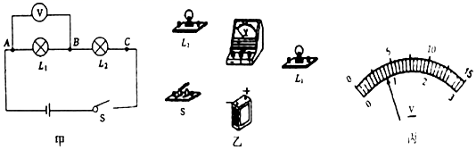

# Physics - 题目 1012

**ID**: 4fc00509d1004766abc72faab41fdbab
**年级**: Grade 9
**难度**: Medium-Hard
**题型**: Experiment

## 题目
小兰同学对串联电路电压规律进行了探究．$\left ({1}\right )$ 根据电路图甲，用笔代替导线连接实物电路图乙．（）$\left ({2}\right )$ 如图甲所示闭合开关，发现 ${\rm{L}}{{}_{1}}$ 不发光， ${\rm{L}}{{}_{2}}$ 比较亮，电压表示数为零，则小灯泡 ${\rm{L}}{{}_{1}}$ 的故障是；$\left ({3}\right )$ 排除故障后，小兰正确测出了 ${\rm{L}}{{}_{1}}$ 两端的电压，在测 ${\rm{L}}{{}_{2}}$ 两端的电压时，小兰打算采用以下方法：电压表所接的B接点不动，只断开A接点，并改接到C接点上．此操作可能会导致电压表出现的现象是．$\left ({4}\right )$ 最后，小兰按照正确的方法测出了 ${\rm{L}}{{}_{1}}$ 、 ${\rm{L}}{{}_{2}}$ 、AC之间的电压 $U{{}_{{\rm{L}}1}}=2.​​​​​​​‌4{\rm{V}}$ ， $U{{}_{{\rm{L}}2}}=1.6{\rm{V}}$ ， $U{{}_{{\rm{A}}{\rm{C}}}}$ 的示数如图丙所示，读出 $U{{}_{{\rm{A}}{\rm{C}}}}=$V，并得出了实验的最终结论．实验结论为：$\left ({5}\right )$ 此实验依然存在着一定的缺陷，你的改进方法是：．

## 解答

1. （1）由电路图知道，两灯泡串联，电压表测量灯泡L_{1}两端电压，故实物电路如下图：
2. 
3. （2）由于发现L_{1}不发光，L_{2}比较亮，且电压表示数为零，所以，说明没有电流通过灯L_{1}，即L_{1 }短路了；
4. （3）只断开电压表A接点，并改接到C接点上，而B接点不动，则电流是从电压表的负接线柱进入，正接线柱流出，即电压表正负接线柱接反了，所以，当闭合开关后，电压表指针会反向偏转；
5. （4）由于电压表测量的是AC间电压，所以选择的电压表的量程应是0～15V；此时电压表分度值为0.5V，所以示数应是4V；由实验数据知道，L_{1}、L_{2}的总电压是：U=U_{L1}+U_{L2}=2.4V+1.4V=3.8V；在误差允许的范围内，可得出实验结论是：串联电路两端的总电压等于各串联部分两端电压之和；
6. 〖交流与评估〗为得出普遍结论，应更换不同规格的灯泡，进行多次实验，测出多组实验数据．

## 知识点

**中文**:
  - 探究串、并联电路中的电压规律实验

**English**:
  - Experiment: Voltage Laws in Series/Parallel

---
