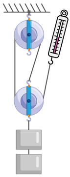

# Physics - 题目 1045

**ID**: 519921bc255a4a49bc9e4a659577f300
**年级**: Grade 9
**难度**: Medium-Hard
**题型**: Experiment

## 题目
在“测量滑轮组的机械效率”的实验中，实验小组用如图所示的装置进行了实验，实验数据记录如表所示。​​​​​​​‌次数钩码所受的重力G/N钩码上升的高度h/cm拉力F/N绳自由端移动的距离s/cm机械效率/%12100.83083.324101.53088.936102.23090.946152.24590.9（1）实验过程中，应缓慢拉动弹簧测力计，使钩码竖直向上做运动；（2）分析1、2、3次实验的数据可知，使用同一滑轮组提升重物时，重物所受重力越大，滑轮组的机械效率越（选填“高”或“低”）；（3）分析3、4次实验的数据可知，滑轮组的机械效率与钩码上升的高度（选填“有关”或“无关”）；（4）结合生产生活实际，用滑轮组提升重物时，下列选项中也可提高机械效率的是（填序号）。

## 解答

1. （1）实验过程中，应缓慢拉动弹簧测力计，使钩码竖直向上做匀速直线运动，此时系统处于平衡状态，测力计示数等于拉力大小。
2. （2）分析1、2、3次实验的数据可知，滑轮组不变，物体的重力越大，机械效率越大，可以得使用同一滑轮组提升重物时，重物重力越大，滑轮组的机械效率越高。
3. （3）分析3、4次实验的数据可知，滑轮组不变，钩码的重力不变，钩码上升的高度不同，滑轮组的机械效率不变，滑轮组的机械效率与钩码上升的高度无关。
4. （4）A．增大绳重，增大了额外功，有用功与总功的比值变小，机械效率变小，故A不符合题意；
5. B．减轻动滑轮重，减小了额外功，有用功与总功的比值变大，机械效率大，故B符合题意；
6. C．滑轮组的机械效率与钩码上升的高度无关，根据 $v=\frac {s}{t}$ 可知机械效率与物体提升的速度无关，故C不符合题意。

## 知识点

**中文**:
  - 滑轮（组）的机械效率的测量实验

**English**:
  - Experiment: Measuring Mechanical Efficiency of Pulleys

---
