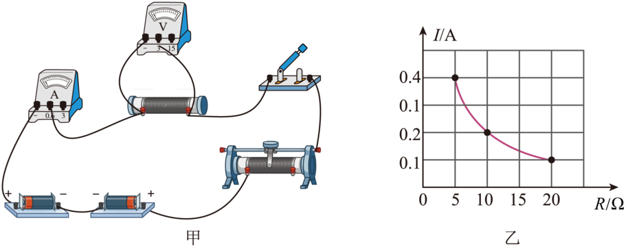

# Physics - 题目 118

**ID**: 533b671b5b3f4b5fb838f823699cd078
**年级**: Grade 9
**难度**: Medium-Hard
**题型**: Experiment

## 题目
某实验兴趣小组探究“电流与电阻的关系”，使用的实验器材有：电源（3V），电流表、电压表、开关各一个，阻值为5Ω、10Ω、20Ω、30Ω、50Ω的定值电阻各一个，标有“20Ω 1A”字样滑动变阻器一个及导线若干。​​​​​​​‌（1）连接电路时，开关应；闭合开关前，滑动变阻器的滑片应置于阻值最大的位置；（2）小明连接的电路如图甲所示，连接有误的电路元件是；（3）纠正连线错误后，小明将阻值为 5Ω、10Ω、20Ω 的定值电阻分别接入电路进行实验，得到数据如图乙所示；当他把 30Ω 的定值电阻接入电路，移动滑动变阻器滑片过程中，眼睛应该观察表的示数变化，当示数为时，记录数据；（4）由图像可以得出结论：电压一定时，通过导体的电流与导体的电阻成；（5）当小明改用 50Ω 的定值电阻继续实验时，发现无论怎样调节滑动变阻器，都无法使电压表示数达到实验要求的值。不增加其他实验器材，为了继续完成实验，可采取的方法是：。

## 解答

1. （1）连接电路时，为了保护电路开关应断开。
2. （2）电源的组装中电池正极与另一节电池的负极相连，图中两节电池的负极连接到了一起，因此是错误的。
3. （3）据乙图可知，实验中定值电阻两端电压为 $U{{}_{R}}=0.4{\rm{A}}\times 5{\rm{Ω}}=2{\rm{V}}$ ，探究电流与电阻关系的实验中需要保持定值电阻两端电压不变，因此当把 30Ω 的定值电阻接入电路，移动滑动变阻器滑片过程中，眼睛应该观察电压表，电压表的示数为2V时，停止移动变阻器记录实验数据。
4. （4）实验中当定值电阻两端电压不变时，根据图像可知，电流与电阻的乘积保持不变，且当电阻变大时，电流变小，因此可得结论为：电压一定时，通过导体的电流与导体的电阻成反比。
5. （5）当定值电阻阻值为50Ω时，定值电阻两端电压为2V，电源电压为3V，根据串联分压原理可得 $\frac {2{\rm{V}}}{50{\rm{Ω}}}=\frac {3{\rm{V}}-2{\rm{V}}}{R{{}_{P}}}$ ，解得变阻器接入电路中的阻值为 $R{{}_{P}}=25{\rm{Ω}}$ ，超过变阻器的最大阻值，说明变阻器分压能力不够，因此当小明改用 50Ω 的定值电阻继续实验时，可将5Ω的定值电阻串联接入电路，辅助变阻器分担电压。

## 知识点

**中文**:
  - 电流与电阻关系的探究实验

**English**:
  - Experiment: Relationship between Current and Resistance

---
