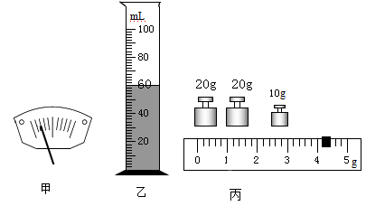

# Physics - 题目 2798

**ID**: 565efd58d7f4436eabc9134729a4536e
**年级**: Grade 9
**难度**: Medium-Hard
**题型**: Experiment

## 题目
突如其来的“新冠病毒”疫情给全国人民带来了很大的影响，为了预防病毒，小明的妈妈采购了消毒液进行日常杀菌，为了测量某消毒液的密度，小明同学进行如下实验操作：(1)将天平放置在水平桌面上。​​​​​​​‌游码归零后，调节平衡螺母前，中央分度盘的指针偏转如甲图，应当向调节平衡螺母，直到天平横梁水平平衡。（选填“左”或“右”）(2)用调节好的天平测出烧杯和适量消毒液的总质量为108.2g，将烧杯中的消毒液倒出一部分到量筒中，量筒中消毒液面位置如图乙所示，则量筒中消毒液的体积为cm^{3}；用天平测出剩余消毒液和烧杯的质量如图丙所示，则消毒液的密度为kg/m^{3}。(3)分析以上步骤，你认为小明所测消毒液的密度。（选填“偏大”“偏小”或“准确”）；(4)小明认为不需要量筒也能测出消毒液的密度。他找来了弹簧测力计、一只空烧杯、细线、石块、适量的水。实验步骤如下：①用细绳拴住石块，并用弹簧测力计测出石块重为G；②将石块浸没在水中，并记录弹簧测力计的读数F_{1}；③；④消毒液密度的表达式为：ρ_{消毒液}=，（水的密度用ρ_{水}表示）

## 解答

1. (1)[1]游码归零后，调节平衡螺母前，中央分度盘的指针左偏，应当向右调节平衡螺母，直到天平横梁水平平衡。
2. (2)[2]由图可知量筒中消毒液的体积为60.0cm^{3}。
3. [3]量筒中的液体质量为
4. $108.2{\rm{g}}-\left ({20{\rm{g}}{\rm{+}}{\rm{2}}{\rm{0}}{\rm{g}}+10{\rm{g}}+4.2{\rm{g}}}\right )=58.0{\rm{g}}$
5. 由密度的定义式可知
6. $ρ=\frac {M}{V}=\frac {58.0{\rm{g}}}{60.0{\rm{c}}{\rm{m}}{^{{\rm{3}}}}}=0.97{\rm{g}}{\rm{/}}{\rm{c}}{\rm{m}}{^{{\rm{3}}}}=0.97\times 10{^{3}}{\rm{k}}{\rm{g}}{\rm{/}}{\rm{m}}{^{{\rm{3}}}}$
7. (3)[4]分析以上步骤，可知有些消毒液沾在量筒壁上，这样测得体积偏小，密度偏大。
8. (4)[5]根据阿基米德原理可求出石块排开液体的体积即为石块的体积。
9. [6]由阿基米德原理可求出石块排开液体的体积
10. $ρ{{}_{水}}gV=G-F{{}_{1}}$
11. 设石块重力为 $G$ ，密度为 $ρ$ ，则有
12. $G=mg=ρgV$
13. 联立以上各式可得
14. $ρ=\frac {m}{V}=\frac {Gρ{{}_{水}}}{G-F{{}_{1}}}$

## 知识点

**中文**:
  - 利用浮力知识测密度
  - 液体密度的测量实验

**English**:
  - Measuring Density using Buoyancy
  - Experiment: Measuring Density of Liquids

---
