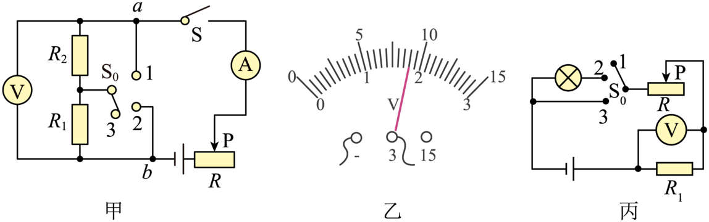

# Physics - 题目 228

**ID**: 57389d25379840588bce27ecbbd35a7c
**年级**: Grade 9
**难度**: Medium-Hard
**题型**: Experiment

## 题目
学校创新小组用如图甲所示的电路来探究“电流与电阻的关系”，选用了阻值分别为5Ω和10Ω的定值电限 $R{{}_{1}}$ 和 $R{{}_{2}}$ ，电压恒为6V的咆源，“50Ω  1A”的滑动变阻器R，多挡开关 ${\rm{S}}{{}_{0}}$ 等器材。​​​​​​​‌（1）为使 $R{{}_{1}}$ 单独接入ab间，闭合开关 ${\rm S，}{\rm{S}}{{}_{0}}$ 应接（选填“1”或“2”）挡。接好电路发现电流表指针几乎不动，电压表示数接近6V，原因可能是 $R{{}_{1}}$（选填“短路”或“断路”）。（2）排除故障后，调节滑动变阻器的滑片P，当电压表示数如图乙所示时，记录电流表示数。改变 ${\rm{S}}{{}_{0}}$ 接入挡位，使 $R{{}_{2}}$ 单独接入ab间，向（填“左”或“右”）调节滑片P，直至电压表示数为V，记录电流表示数。（3）闭合开关 ${\rm S，}{\rm{S}}{{}_{0}}$ 接挡，使ab间接入阻值最大，重复前面的实验并记录电流表示数。分析数据发现，电流表示数随电阻的增大成比例减小，从而得出结论：电压一定时，通过导体的电流与导体的电阻成比。（4）该组同学选用上述部分器材设计了如图丙所示的电路，测量额定电流为0.3A的小灯泡的额定功率，请将实验过程补充完整：① ${\rm{S}}{{}_{0}}$ 接2挡，调节R的滑片P，使电压表示数为V，小灯泡正常发光；② ${\rm{S}}{{}_{0}}$ 接3挡，保持滑片P位置不动，读出此时电压表示数为3V；③算出小灯泡的额定功率 $P{{}_{{\rm{额}}}}=$W。

## 解答

1. （1）S_{0}接1挡时，电流从正极出发，经滑动变阻器R、电流表、开关S、S_{0}、R_{1}流回到电源负极，R_{2}被短路，此时R_{1}单独接入ab间。
2. 接好电路发现电流表指针几乎不动，说明电路为断路，电压表示数接近电源电压6V， 说明电压表与电源的两端相连。故电流故障为与电压表并联的R_{1}断路。
3. （2）由图乙知，电压表的量程为0-3V，分度值为0.1V，示数为1.8V。要探究电流与电阻的关系，需要控制电阻两端的电压不变，实验时保持滑片位置不动，改变S_{0}接入挡位，使R_{2}单独接入ab间，R_{2}的电阻大于R_{1}的电阻，根据串联电路的分压作用，R_{2}分得的电压增大，电压表示数变大，为了使电压表示数不变，需要增大滑动变阻器的电阻，故将滑动变阻器的滑片向右移动，直至电压表示数为1.8V不变。
4. （3）闭合开关S，S_{0}接1挡时，只有R_{1}单独接入ab间，S_{0}接2挡时，只有R_{2}单独接入ab间，S_{0}接3挡时，R_{1}和R_{2}串联接入ab间，ab间接入阻值最大。分析数据发现，电流表示数随电阻的增大成比例减小，从而得出结论：电压一定时，通过导体的电流与导体的电阻成反比。
5. （4）由图丙可知，要使小灯泡正常发光，需使小灯泡接入电路，所以S_{0}接2挡，调节R的滑片P，由于小灯泡正常发光时的电流为0.3A，所以应使电压表示数为U_{1}=I_{额}R_{1}=0.3A×5Ω=1.5V，S_{0}接3挡，定值电阻R_{1}与滑动变阻器串联，保持滑片P位置不动，读出此时电压表示数为3V，此时电路的电流为 $I\mathrm{′}=\frac {U{{}_{1}}\mathrm{′}}{R{{}_{1}}}=\frac {{{3}}{\rm{V}}}{5Ω}=0.6{\rm{A}}$ ，根据串联电路电压的规律知，此时滑动变阻器两端的电压为U_{滑}=U-U′=6V-3V=3V，滑动变阻器接入的电阻为 $R{{}_{滑}}=\frac {U{{}_{滑}}}{I\mathrm{′}}=\frac {{{3}}{\rm{V}}}{{{0}}{{.}}{{6}}{\rm{A}}}=5Ω$ ，由于滑片位置不变，所以S_{0}接2挡时，滑动变阻器接入的电阻为5Ω，小灯泡正常发光，小灯泡的额定电压为U_{额}=U-I（R_{1}+R_{滑}）=6V-0.3A×（5Ω+5Ω）=3V，小灯泡的额定功率为P_{额}=U_{额}I_{额}=3V×0.3A=0.9W。

## 知识点

**中文**:
  - 其他方法测量小灯泡的电功率
  - 电流与电阻关系的探究实验

**English**:
  - Other Methods for Measuring Bulb Power
  - Experiment: Relationship between Current and Resistance

---
