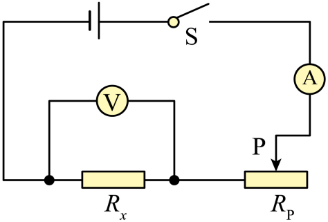

# Physics - 题目 1896

**ID**: 5993e14ad02e43268fefd3a4999e3c86
**年级**: Grade 9
**难度**: Medium-Hard
**题型**: Experiment

## 题目
小明利用如图“探究电流与电压和电阻的关系”两个实验，实验室提供的器材有：电压恒为6V的电源一个，定值电阻5个（阻值分别为 $5Ω$ 、 $10Ω$ 、 $15Ω$ 、 $20Ω$ 、 $30Ω$ ），规格为“ $50Ω$   1A”的滑动变阻器一个，电流表、电压表、开关各一个，导线若干。​​​​​​​‌（一）探究电流与电压的关系（1）小明用 $5Ω$ 完成了预先设计好的表格中的5次实验，将得到的实验数据填入下表格。实验次数12345678电压U/V11.522.53456电流I/A0.20.30.40.50.6分析表中已测出的数据，可以初步得到实验结论：在电阻一定的情况下，通过导体的电流与导体两端的电压成。为了进一步验证这个结论，该同学利用现有器材在不改变电路连接的情况下，表格里余下的3次实验中，为保护器材，他还能完成次；（2）该实验不能用灯泡来代替电阻，原因是；（二）探究电流与电阻的关系（3）小明预设电阻 $R{{}_{{\rm{x}}}}$ 两端的电压为2V，根据上面提供的器材，把 $R{{}_{{\rm{x}}}}$ 换成$Ω$ 的电阻时，实验无法完成。小明想出了如下措施，请帮他完成：①在不更换器材的基础上，可以把电阻 $R{{}_{{\rm{x}}}}$ 两端的电压预设为V及以上；②预设电阻 $R{{}_{{\rm{x}}}}$ 两端的电压为2V不改变，可以在原电路的基础上再串联一个阻值最小为$Ω$ 的电阻。

## 解答

1. （1）由表中数据可知，导体两端的电压与通过导体的电流的比值 $\frac {1{\rm{V}}}{0.2{\rm{A}}}=\frac {1.5{\rm{V}}}{0.3{\rm{A}}}=\frac {2{\rm{V}}}{0.4{\rm{A}}}=\frac {2.5{\rm{V}}}{0.5{\rm{A}}}=\frac {3{\rm{V}}}{0.6{\rm{A}}}=5$ ，导体两端的电压与通过导体的电流的比值一定，所以在电阻一定的情况下，通过导体的电流与导体两端的电压成正比。
2. 当定值电阻两端的电压为6V时，电路中的电流 $I=\frac {U}{R}=\frac {6{\rm{V}}}{5{\rm{Ω}}}=1.2{\rm{A}}$
3. 滑动变阻器的规格是“ $50Ω$  1A”，所以第8次实验不能完成，当定值电阻两端的电压为5V时，电路中的电流 $I^{′}=\frac {U^{′}}{R}=\frac {5{\rm{V}}}{5{\rm{Ω}}}=1{\rm{A}}$
4. 所以第6次实验和第7次实验可以完成，为保护器材，他还能完成2次实验。
5. （2）探究电流与电压的关系时，要控制电阻的阻值不变，灯泡的阻值随温度发生变化，所以该实验不能用灯泡来代替电阻。
6. （3）探究电流与电阻的关系时，要控制电阻两端电压不变，预设电阻两端的电压为2V，当 $30Ω$ 的电阻接入电路中时，电路中的电流 $I{{}_{1}}=\frac {U{{}_{1}}}{R{{}_{1}}}=\frac {2{\rm{V}}}{30{\rm{Ω}}}=\frac {1}{15}{\rm{A}}$ ，滑动变阻器接入电路中的阻值 $R{{}_{滑}}=\frac {U{{}_{总}}-U{{}_{1}}}{I{{}_{1}}}=\frac {6{\rm{V}}-2{\rm{V}}}{\frac {1}{15}{\rm{A}}}=60{\rm{Ω}}$ ，滑动变阻器的规格是“ $50Ω$  1A”，所以实验无法完成，若要完成实验，可以在电路中串联一个阻值最小为10Ω的电阻，使该电阻和滑动变阻器串联的总电阻等于60Ω。
7. 不更换器材，当 $30Ω$ 的电阻和滑动变阻器的最大阻值接入电路中时，电路中的电流 $I{^{^{′′}}}=\frac {U{{}_{总}}}{R{{}_{1}}+R{{}_{滑大}}}=\frac {6{\rm{V}}}{30{\rm{Ω}}+50{\rm{Ω}}}=0.075{\rm{A}}$ ，电阻两端的电压 ${\rm \mathit{U}''=\mathit{I}''\mathit{R}_{1}=0.075A×30}Ω{\rm =2.25V}$

## 知识点

**中文**:
  - 电流与电压关系的探究实验
  - 电流与电阻关系的探究实验

**English**:
  - Experiment: Relationship between Current and Voltage
  - Experiment: Relationship between Current and Resistance

---
