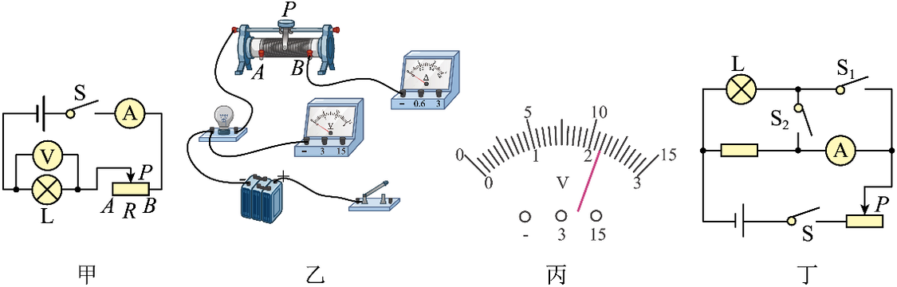

# Physics - 题目 2330

**ID**: 5be5799b0c7d450b97084abdc7a16996
**年级**: Grade 9
**难度**: Medium-Hard
**题型**: Experiment

## 题目
实验小组在“测量小灯泡的额定功率”实验中，选用了以下实验器材：电压恒定为 $6{\rm{V}}$ 的电源、电流表、电压表、额定电压为 $2.5{\rm{V}}$ 的小灯泡（正常发光时灯丝的电阻约为 $10\mathrm{Ω}$ ）、滑动变阻器、开关和导线若干，设计的电路图如图甲所示。​​​​​​​‌（1）请你将图乙所示的实物电路连接完整（导线不交叉）；（2）若闭合开关，小灯泡很亮，无论怎样移动滑动变阻器滑片，小灯泡亮度始终不变，则故障原因可能是；（3）为能顺利完成该实验，下列不同规格的滑动变阻器应选用（选填字母）；

## 解答

1. （1）由图甲可知灯泡和滑动变阻器串联，电压表测灯泡两端的电压，因灯泡的额定电压是2.5V，所以电压表选择小量程接入，若小灯泡正常发光，则电流约为 $I=\frac {U}{R}=\frac {2.5{\rm{V}}}{10{\rm{Ω}}}=0.25{\rm{A}}$ ，所以电流表也选择小量程接入。
2. （2）闭合开关后小灯泡很亮，说明电路中的电阻偏小，无论怎样移动滑动变阻器滑片，小灯泡亮度始终不变，说明滑动变阻器没有起到改变电路中电阻的作用，可能的原因是将滑动变阻器的金属杆接入了电路。
3. （3）根据串联分压的原理可知滑动变阻器分到的电压为 $U=U{{}_{电}}-U{{}_{{\rm{L}}}}=6{\rm{V}}-2.5{\rm{V}}=3.5{\rm{V}}$ ，由上述计算可知小灯泡正常发光时的电流约为0.25A，则滑动变阻器的电阻约为 $R{{}_{变}}=\frac {U}{I}=\frac {3.5{\rm{V}}}{0.25{\rm{A}}}=14{\rm{Ω}}$ ，所以应选择最大阻值是20Ω的滑动变阻器，故B符合题意，A不符合题意。
4. （4）根据灯泡的额定电压可知电压表是小量程接入，分度值是0.1V，示数是2.2V，则小灯泡的实际功率为 $P=U^{′}I^{′}=2.2{\rm{V}}\times 0.3{\rm{A}}=0.66{\rm{W}}$ ，为了测量小灯泡的额定功率，应增大小灯泡的实际电压，根据串联电路的分压原理可知应减小滑动变阻器的电压，所以应减小滑动变阻器的阻值，即将滑片向B端滑动。
5. （5）若要完成探究通过定值电阻的电流与电压的关系的实验时，应保证电阻的阻值不变，而图乙中小灯泡在实际使用过程中电阻会随着温度的升高而变大，所以不能探究通过定值电阻的电流与电压的关系。
6. （6）闭合开关S和S_{1}，断开S_{2}，灯泡和定值电阻并联后与滑动变阻器串联，电流表测定值电阻的电流，移动变阻器的滑片，使电流表示数为 $\frac {U{{}_{额}}}{R{{}_{0}}}$ ；闭合开关S和S_{2}，断开S_{1}，灯泡和定值电阻并联后与滑动变阻器串联，电流表测干路的电流，保持变阻器滑片的位置不动，则此时电路的构成与原电路相同，读出电流表的示数I，即干路电流是I，则通过灯泡的电流为 $I{{}_{{\rm{L}}}}=I-\frac {U{{}_{额}}}{R{{}_{0}}}$ ，则小灯泡的额定功率为 $P{{}_{额}}=U{{}_{额}}I{{}_{{\rm{L}}}}=U{{}_{额}}\left ({I-\frac {U{{}_{额}}}{R{{}_{0}}}}\right )$ 。

## 知识点

**中文**:
  - 其他方法测量小灯泡的电功率

**English**:
  - Other Methods for Measuring Bulb Power

---
