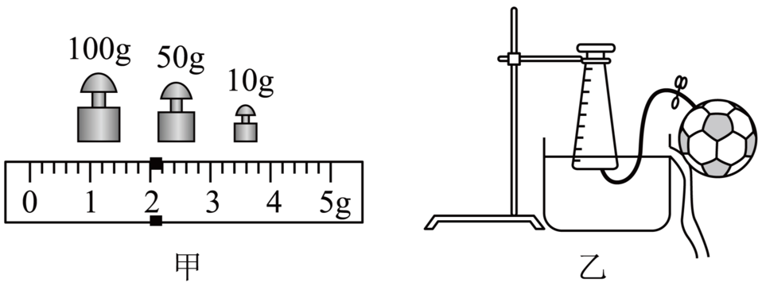

# Physics - 题目 2625

**ID**: 5fbb1716443a4f9ea945ea5b5e94d885
**年级**: Grade 9
**难度**: Medium-Hard
**题型**: Experiment

## 题目
某物理兴趣小组采用“皮球排气法”测量空气的密度，实验步骤如下：步骤一：将打足气的皮球放在已调节好的天平左盘，再次调节天平平衡时，右盘中的砝码和标尺上游码位置如图甲所示；步骤二：将100mL量杯装满水后倒放入装满水的水槽中，100mL刻度线与水面齐平；将带夹软管一端连接皮球的气嘴，另一端放在量杯内，准备排水集气，如图乙所示；步骤三：打开管夹向量杯中注入空气，当水面回落到100mL刻度线时，夹住软管，暂停放气；步骤四：重复步骤二和三的操作，共进行10次。​​​​​​​‌拆除气针和软管，用天平称量放气后的皮球，示数为160.6g；放气前后，皮球的体积变化可忽略不计，请回答下列问题：（1）步骤二中，量杯中的水没有落回水槽，是因为；（2）上述实验过程共排出空气的质量为g；（3）根据实验数据，测算出空气的密度为g/cm^{3}；（4）若实验时有两次不小心放气过多有一部分气体不慎溢出，则所测量的空气密度值会（选填“偏大”“偏小”或“不变”）。

## 解答

1. （1）[1]观察图乙，可知道，水槽上方有空气，有大气压强，而量杯中的水没有落回水槽，这类似于托里拆利实验，水槽上方的大气压强，支撑着量杯中的水，所以量杯中的水没有落回水槽。
2. （2）[2]根据步骤一，可知道打足气的皮球，它的质量如图甲所示，图甲中有砝码100g、50g、10g各一个，游码示数为2.0g，则可知道打足气的皮球质量
3. $m={\rm{1}}{\rm{0}}{\rm{0}}{\rm{g}}+{\rm{5}}{\rm{0}}{\rm{g}}+{\rm{1}}{\rm{0}}{\rm{g}}+{\rm{2}}{\rm{.}}{\rm{0}}{\rm{g}}={\rm{1}}{\rm{6}}{\rm{2}}{\rm{.}}{\rm{0}}{\rm{g}}$
4. 打足气的皮球质量为162.0g；再由步骤四，可知道放气后的皮球，质量 $m{^{^{′}}}={\rm{1}}{\rm{6}}{\rm{0}}{\rm{.}}{\rm{6}}{\rm{g}}$ ；则上述实验过程共排出空气的质量
5. $m{{}_{空}}=m-m{^{^{′}}}={\rm{1}}{\rm{6}}{\rm{2}}{\rm{.}}{\rm{0}}{\rm{g}}-{\rm{1}}{\rm{6}}{\rm{0}}{\rm{.}}{\rm{6}}{\rm{g}}={\rm{1}}{\rm{.}}{\rm{4}}{\rm{g}}$
6. 总共排出空气的质量为1.4g。
7. （3）[3]根据步骤三可知，当水面回落到100mL刻度线时，夹住软管，暂停放气，即每一次排放的空气体积大小等于100mL水的体积，则
8. $V{{}_{空}^{^{′}}}=V{{}_{水}}={\rm{1}}{\rm{0}}{\rm{0}}{\rm{m}}{\rm{L}}={\rm{1}}{\rm{0}}{\rm{0}}{\rm{c}}{\rm{m}}{^{{\rm{3}}}}$
9. 再由步骤四可知，重复步骤二和三的操作，共进行10次，那么皮球总共放出空气的体积
10. $V{{}_{空}}=10V{{}_{空}^{^{′}}}=10\times {\rm{1}}{\rm{0}}{\rm{0}}{\rm{c}}{\rm{m}}{^{{\rm{3}}}}={\rm{1}}{\rm{0}}{\rm{0}}{\rm{0}}{\rm{c}}{\rm{m}}{^{{\rm{3}}}}$
11. 皮球总共放出空气的体积为1000cm^{3}；根据[2]解析可知，总共排出空气的质量为1.4g，再根据密度公式 $ρ=\frac {m}{V}$ 可知，空气的密度
12. $ρ{{}_{空}}=\frac {m{{}_{空}}}{V{{}_{空}}}=\frac {{\rm{1}}{\rm{.}}{\rm{4}}{\rm{g}}}{{\rm{1}}{\rm{0}}{\rm{0}}{\rm{0}}{\rm{c}}{\rm{m}}{^{{\rm{3}}}}}=1.4\times {\rm{1}}{\rm{0}}{^{{\rm{-}}{\rm{3}}}}{\rm{g}}{\rm{/}}{\rm{c}}{\rm{m}}{^{{\rm{3}}}}$
13. 空气的密度为1.4×10^{-3}g/cm^{3}。
14. （4）[4]若实验时有两次不小心放气过多有一部分气体不慎溢出，那么计算的空气体积是小于实际排放出来的体积，计算排放的空气质量是准确的，根据密度公式 $ρ=\frac {m}{V}$ 可知，所测量的空气密度值会偏大。

## 知识点

**中文**:
  - 特殊方法测密度

**English**:
  - Special Methods for Measuring Density

---
