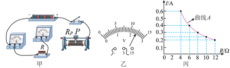

# Physics - 题目 618

**ID**: 620f30c0b7314b778bb281c113650001
**年级**: Grade 9
**难度**: Medium-Hard
**题型**: Experiment

## 题目
用图甲所示电路“探究电流与电阻的关系”。​​​​​​​‌电源电压为4.5V不变，滑动变阻器规格为“20Ω　1A”，有4Ω、6Ω、8Ω、10Ω、12Ω的定值电阻各一个。（1）用笔画线代替导线把图甲电路连接完整，要求：当滑片P向左滑动时，变阻器接入电路的电阻变大；（2）连接电路时，开关应该（选填“断开”或“闭合”）；（3）先接入12Ω定值电阻，闭合开关，移动变阻器的滑片P至合适位置，电压表的示数如图乙所示，示数为V，记下电流表的示数。断开开关，将12Ω电阻换成10Ω后，闭合开关，移动变阻器的滑片P使表的示数与前一次相同，记录相关数据；（4）依次改变电阻R的阻值，共测得五组实验数据，根据实验数据，在图丙的坐标系中描绘出I—R图像为曲线A；①由图像可得出的结论是：；②根据上面所测的五组实验数据，把每次实验时记录的电流值和对应变阻器R_{P}的阻值，在图丙坐标系中描成点，将这些点绘成曲线B，发现曲线B与曲线A（选填“有交点”或“无交点”），其原因是；③本实验的主要研究方法是“控制变量法”，下列物理教材中的实验，没有用到“控制变量法”的有。

## 解答

1. （1）“探究电流与电阻的关系”的实验，滑动变阻器与定值电阻串联，电压表并联在定值电阻两端，当滑片P向左滑动时，变阻器接入电路的电阻变大，故滑动变阻器应接右下的接线柱，如图所示：
2. 。
3. （2）为了保护电路，所以连接电路时开关应断开。
4. （3）由图乙可知，电压表所选量程为0～3V，分度值为0.1V，故图乙电压表的示数为2.4V。根据串联分压原理可知，将定值电阻由12Ω改接成10Ω的电阻，电阻减小，其分得的电压减小；“探究电流与电阻关系”的实验中应保持电阻两端的电压不变，所以应移动变阻器的滑片P使电压表的示数与前一次相同，记录相关数据。
5. （4）①由图像丙可知，电流与电阻的乘积 $U=IR=0.6{\rm{A}}\times 4{\rm{Ω}}=0.4{\rm{A}}\times 6{\rm{Ω}}=0.3{\rm{A}}\times 8{\rm{Ω}}=0.2{\rm{A}}\times 12{\rm{Ω}}=2.4{\rm{V}}$ 为一定值，且电流随电阻的增大而减小，故可得出的结论是：当电压一定时，通过导体的电流与导体的电阻成反比。
6. ②“探究电流与电阻关系”的实验中应保持电阻两端的电压不变，又电源电压不变，所以滑动变阻器两端的电压也不变，且定值电阻与滑动变阻器串联，故电流相等；由图像丙可知，定值电阻两端的电压保持在2.4V不变，故滑动变阻器两端的电压保持在2.1V不变，由串联分压可知，每次实验滑动变阻器接入电路的阻值都比定值电阻小，把每次实验时记录的电流值和对应变阻器R_{P}的阻值，在图丙坐标系中描成点，将这些点绘成曲线B，发现曲线B与曲线A无交点。
7. ③A．“探究二力平衡的条件”实验，采用的是控制变量法；故A不符合题意；
8. B．“探究影响液体内部压强的因素”采用的是控制变量法；故B不符合题意；
9. C．“用电流表和电压表测量定值电阻的阻值”是一个测量型实验，利用多次测量求平均值减小误差，没有采用控制变量法，故C符合题意。

## 知识点

**中文**:
  - 电流与电阻关系的探究实验

**English**:
  - Experiment: Relationship between Current and Resistance

---
