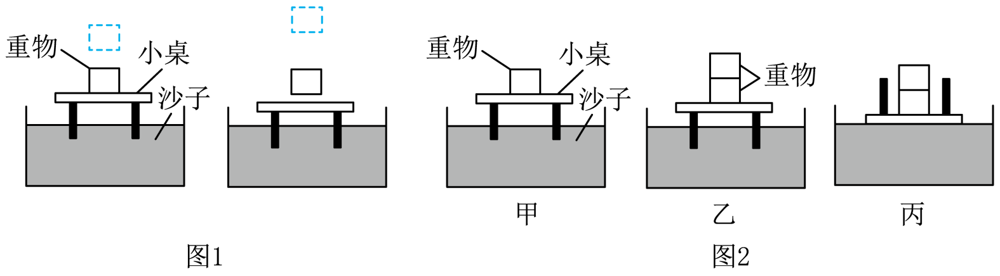

# Physics - 题目 2714

**ID**: 6909bb57b32645ed9c142972f675b3ca
**年级**: Grade 9
**难度**: Medium-Hard
**题型**: Experiment

## 题目
小雨和小明利用沙子、小桌、重物、透明的箱子进行实验探究。​​​​​​​‌（1）如图1所示，把小桌放在透明的沙箱中，让重物从高处落下，撞击小桌，观察桌腿陷入沙子的深度，探究重力势能的大小与哪些因素有关。①实验探究的是（填“重物”或“小桌”）的重力势能；②通过实验，发现同一个重物从不同高度落下，高度越高，能够对外做功越，说明它的重力势能越；③要进一步探究重力势能与质量的关系，应换用不同的重物，让它们从同一高度落下，观察桌腿陷入沙子的深度。（2）把重物按图2所示方式分别放在小桌上，观察小桌陷入沙子的深度，探究压力作用效果与什么因素有关。①在分析压力作用效果与压力大小的关系时，小雨选择甲、乙两次实验进行比较，得出结论：压力越大，压力作用效果越明显；小明选择甲、丙两次实验进行比较，得出结论：压力越大，压力作用效果越不明显，你认为的实验结论是错误的，理由是；②分析两次实验可发现压力作用效果与力面积有关；（3）上述探究过程中都通过小桌陷入沙子的深度来显示要探究的问题，下列实验中也用到这种研究方法是（填字母）。

## 解答

1. （1）①[1]实验中，重物从高处落下撞击小桌，通过小桌下陷的深度判定重物重力势能的大小，所以实验探究的是重物的重力势能。
2. ②[2][3]根据
3. $W=Fs=Gh$
4. 同一个重物的重力不变，从不同高度落下，高度越高，能够对外做功越多，小桌下陷的深度越大，说明它的重力势能越大。
5. （2）①[4][5]在分析压力作用效果与压力大小的关系时，根据控制变量法可知，实验中需要控制受力面积相同，改变压力的大小；小雨选择甲、乙两次实验进行比较，甲、乙的压力不同，受力面积相同，压力越大，小桌下陷的深度越大，压力作用效果越明显；小明选择甲、丙两次实验进行比较，甲、丙的压力不同，受力面积不同，所以不能得出正确的结论。故小明的结论是错误的，原因是没有控制受力面积相同。
6. ②[6]根据乙和丙可知，压力的大小相同，受力面积不同，受力面积越大，压力的作用效果越不明显，所以压力的作用效果与受力面积的大小有关。
7. （3）[7]上述探究过程中都通过小桌陷入沙子的深度来显示压力作用效果，采用的是转换法。
8. A．测量物体运动的速度时，实验原理是 $v=\frac {s}{t}$ ，采用的是公式法，故A不符合题意；
9. B．探究物质的吸热能力时，根据温度计升高的示数来显示物质吸热能力的大小，采用的是转换法，故B符合题意；
10. C．探究电流与电压、电阻的关系时，采用的是控制变量法，故C不符合题意。
11. 故选B。

## 知识点

**中文**:
  - 探究影响压力作用效果因素的实验
  - 探究影响物体重力势能大小因素的实验

**English**:
  - Experiment: Factors Affecting Pressure Effect
  - Experiment: Factors Affecting Gravitational Potential Energy

---
