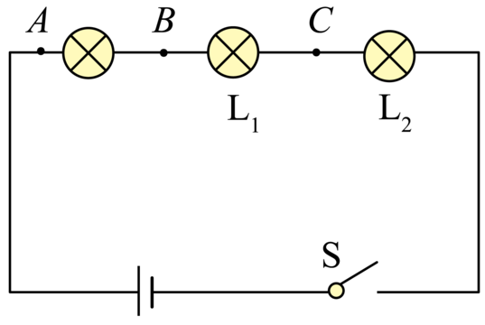

# Physics - 题目 2312

**ID**: 6b67bfb78dc540c2a0f273f16e7aab7e
**年级**: Grade 9
**难度**: Medium-Hard
**题型**: Experiment

## 题目
小希用如图所示电路来探究串联电路的电压特点。​​​​​​​‌（1）由实验表格可知，选择的电源电压为V；实验次数$U{{}_{{\rm AB}}}/{\rm V}$$U{{}_{{\rm BC}}}/{\rm V}$$U{{}_{{\rm AC}}}/{\rm V}$1$0.8$$2.2$$3.0$2$1.0$$2.0$$3.0$3$1.2$$1.8$$3.0$（2）实验中最好选择规格（填“相同”或“不同”）的小灯泡；（3）用电压表分别测出A与B、B与C、A与C两点间的电压为 $U{{}_{AB}}$ 、 $U{{}_{BC}}$ 、 $U{{}_{AC}}$ ，经过多次实验，得到的数据记录在下表中。分析实验数据，你可得到串联电路的电压特点是（用公式表示）；（4）小希进行多次实验的主要目的是（选填序号）；①寻找普遍规律   ②减小实验误差

## 解答

1. （1）[1]根据电路图，AC间的电压即为电源电压，根据表中数据知， $U{{}_{AC}}=3.0{\rm{V}}$ ，故电源电压为3.0V。
2. （2）用归纳法得出普遍性的结论要满足2个条件：一是样本要有代表性，二是样本数量足够多；实验中为了是实验结论具有普遍性，最好选择规格不同的小灯泡，进行多次实验，归纳实验结论。
3. （3）[3]根据表中数据有
4. $U{{}_{AC}}=U{{}_{AB}}+U{{}_{BC}}=0.8{\rm{V}}+2.2{\rm{V}}=1.0{\rm{V}}+2.0{\rm{V}}=1.2{\rm{V}}+1.8{\rm{V}}=3.0{\rm{V}}$
5. 故得到串联电路的电压特点是
6. $U{{}_{AC}}=U{{}_{AB}}+U{{}_{BC}}$
7. （4）[4]小希进行多次实验的主要目的是避免实验的偶然性，寻找普遍规律，故选①。

## 知识点

**中文**:
  - 电流与电阻关系的探究实验

**English**:
  - Experiment: Relationship between Current and Resistance

---
