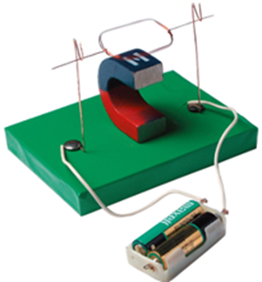

# Physics - 题目 3000

**ID**: 6cb4bf2c8d9e461cb2401f4835cd4ba1
**年级**: Grade 9
**难度**: Medium-Hard
**题型**: Experiment

## 题目
在制作小电动机模型时，把一段粗漆包线绕成约3cm×2cm的矩形线圈，漆包线在线圈的两端各伸出约3cm，然后用小刀刮两端引线的漆皮，如图用硬金属丝做两个支架，固定在硬纸板上，两个支架分别与电池的两极相连。​​​​​​​‌把线圈放在支架上，线圈下放一块强磁铁。（1）在漆包线两端用小刀刮去引线的漆皮，为使线圈能够持续转动，刮线的要求是（填选项“A”或“B”）；

## 解答

1. （1）为了使线圈能够持续转动，可以将线圈一端的绝缘漆全部刮去，另一端刮去一半，这样线圈在一个半周内受到磁场的力的作用，另一个半周利用惯性转动，故选B。
2. （2）接通电源后，线圈不转动，则可能是线圈处于平衡位置，故可用手轻推一下线圈。
3. （3）将电源的两极位置对调，电流的方向发生了变化，将强磁铁磁极的位置对调，磁场的方向发生了变化，可知，通电导体在磁场中受到的力的方向与电流方向和磁场方向都有关。
4. （4）线圈在转动过程中消耗电能，故是将电能转化为机械能。
5. （5）灵敏电流计的指针左右摆动，说明电流的方向在发生变化，故线圈在磁场中转动时产生了交流电。

## 知识点

**中文**:
  - 交流电
  - 磁场对通电导线的作用
  - 直流电动机的构造和工作过程

**English**:
  - Alternating Current (AC)
  - Effect of Magnetic Field on Energized Wire
  - Structure and Operation of DC Motor

---
