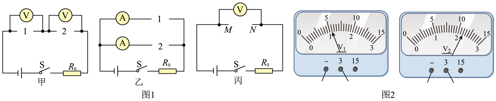

# Physics - 题目 2381

**ID**: 6e5bdf92500e4943a73ad69b93638d56
**年级**: Grade 9
**难度**: Medium-Hard
**题型**: Experiment

## 题目
某学校的三个物理兴趣小组的同学在探究导体电阻与导体长度和横截面积之间的定量关系时，分别设计了如图1所示的甲、乙、丙三种不同电路进行探究。​​​​​​​‌实验室为每小组分别提供如表所示的一组合金电阻丝：编号材料长度/m横截面积/mm^{2}A镍铬合金0.60.4B镍铬合金1.20.4C镍铬合金0.60.8D锰铜合金0.60.8（1）甲实验小组探究导体电阻与导体长度之间的定量关系时，将编号为A、B的两根合金丝对应接入图甲电路1和2的位置；闭合开关，电压表的示数如图2所示，则电压表的示数U_{1}∶U_{2}=，结合如表数据可知合金丝两端电压与合金丝的长度成（选填“正比”或“反比”），可初步判定导体的电阻与导体的长度成（选填“正比”或“反比”）；（2）乙实验小组探究导体电阻与导体横截面积之间的定量关系时，应将编号为的两根合金丝对应接入图乙电路1和2的位置；乙小组实验中若电流表的示数I_{1}∶I_{2}与合金丝的横截面积成正比，则可初步判定导体的电阻与导体的横截面积成（选填“正比”或“反比”）。

## 解答

1. （1）[1][2][3]图中两个电压表都选用小量程，电压表V_{1}的示数为1.1V，V_{2}的示数是2.2V，因此两电压表的示数之比是
2. $\frac {U{{}_{1}}}{U{{}_{2}}}=\frac {{\rm{1}}{\rm{.}}{\rm{1}}{\rm{V}}}{{\rm{2}}{\rm{.}}{\rm{2}}{\rm{V}}}=\frac {1}{2}$
3. 又因为A、B导体的长度之比为1∶2，并且电压表分别测量A、B导体两端的电压，所以当两电压表示数之比接近电阻长度之比时即1∶2，知合金丝两端电压与合金丝的长度成正比。可以断定，当其它条件都不变时，导体的电阻与长度成正比。
4. （2）[4][5]根据控制变量法，探究导体电阻与导体横截面积之间的定量关系时，应选择横截面积不同而材料和程度相同的电阻丝，故选A、C；乙小组实验中；两电阻丝并联，两端的电压相等，若电流表的示数I_{1}∶I_{2}与合金丝的横截面积成正比，说明横截面积越大，电阻越小，因此可初步判定导体的电阻与导体的横截面积成反比。

## 知识点

**中文**:
  - 影响导体电阻大小因素的探究实验

**English**:
  - Experiment: Factors Affecting Resistance

---
