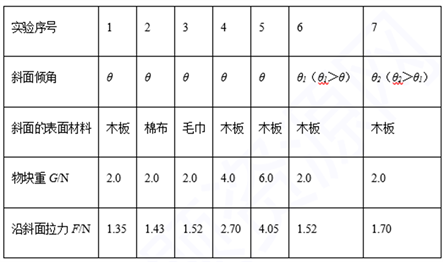
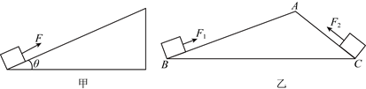

# Physics - 题目 293

**ID**: 6f11c7fcad1e4cb3972062fda3a67bdd
**年级**: Grade 9
**难度**: Medium-Hard
**题型**: Experiment

## 题目
小明骑自行车时发现，骑车上陡坡要吃力些。​​​​​​​‌坡路和斜面相似，那么斜面的省力情况与哪些因素有关呢？小明做了如下猜想：猜想1：与斜面的表面材料有关。猜想2：与斜面的倾斜程度有关。猜想3：与物体受到的重力大小有关。为验证上述猜想，小明利用如图甲所示的装置进行了实验，实验中用沿斜面向上的拉力F拉动物体在斜面上做匀速直线运动。实验中相关的记录如表。（使用斜面的省力情况可以通过比较沿斜面的拉力F与物体所受的重力G的比值大小来判定，比值越小，越省力）（1）通过对比（填写实验序号）三次实验中的数据可知，使用斜面省力的情况与斜面的表面材料有关；（2）通过对比1、6、7三次实验中的数据，得出的结论是：在其他条件相同时，斜面倾角越，斜面越省力；（3）为验证猜想3，小明做了（填写实验序号）三次实验，分析实验数据后，小明认为这几次实验省力情况相同的依据是；（4）下列探究所采用的方法与本实验的主要研究方法相同的是。

## 解答

1. （1）[1]探究斜面省力的情况与斜面的表面材料的关系，需要控制物块重、斜面倾角相同，表面材料不同，所以应该对比1、2、3的数据。
2. （2）[2]对比1、6、7三次实验中的数据可以看出，在斜面的表面材料、物重相同的情况下，倾角越小，拉力越小，因此得出的结论是：在其他条件相同时，斜面的倾斜程度越小，提升物体越省力。
3. （3）[3][4]探究斜面省力的情况与物体受到的重力大小有关时，根据控制变量法可知，实验中需要控制倾角相同、表面材料相同，物体的重力不同，所以需要对比1、4、5三次实验；根据1、4、5的实验数据可知，物体的重力变为原来的几倍，拉力也会变为原来的几倍，即沿斜面的拉力F与物体的重力G的比值大小相等。
4. （4）[5]本实验中采用了控制变量法来探究斜面的省力情况与哪些因素有关。
5. A．探究平面镜成像的实验中，用没有点燃的蜡烛来替代点燃的蜡烛的像，用到等效替代法，故A不符合题意。
6. B．探究滑动摩擦力大小与接触面的粗糙程度的关系时要控制压力相同，运用的是控制变量法，故B符合题意。
7. C．为了形象地描述磁场，引入磁感线，是运用了模型法，故C不符合题意。
8. D．用水流类比电流，采用的是类比法，故D不符合题意。
9. 故选B。
10. （5）[6]由图可知，斜面AB的倾角小于斜面AC的倾角，所以物体沿AB运动时拉力较小，即
11. F_{1}＜F_{2}
12. [7]斜面光滑，所以沿斜面拉物体时不做额外功，即拉力做功等于有用功，而物重和上升高度均相同，则有用功相同，所以拉力在两斜面上做功相同，即
13. W_{1}=W_{2}

## 知识点

**中文**:
  - 斜面与轮轴

**English**:
  - Inclined Plane and Wheel & Axle

---
