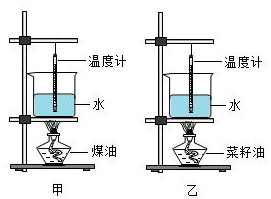

# Physics - 题目 938

**ID**: 70cce4c441bd4c39b3c34e33cac8ecf0
**年级**: Grade 9
**难度**: Medium-Hard
**题型**: Experiment

## 题目
小明同学学习了燃料的热值后，考虑到燃料燃烧放出的热量会被水吸收，而水的比热容已知。​​​​​​​‌自己设计一个实验来探究煤油和菜籽油的热值的大小关系。他组装了图所示的装置进行实验，记录结果见下表：燃料加热前水的温度/℃燃料燃尽后的温度/℃煤油2544菜籽油2534(1)取质量(选填“相等”或“不相等”)的煤油和菜籽油做燃料，制成煤油灯和菜籽油灯；(2)安装实验器材时，应按照(选填“自下而上”或“自上而下”)的顺序安装。为了保证实验结论的可靠，小明同学应该选择两套完全相同的装置，在实验中还应控制温和相同；(3)分析得出：煤油和菜籽油两种燃料中，热值较大的是；(4)实验中燃料燃烧放出的热量，通过(选填“做功”或“热传递”)的方式使内能增大。小明同学利用这种实验方案计算出煤油和菜籽油的热值，那么计算出的热值将比真实值(选填“偏大”或“偏小”)。

## 解答

1. (1)为了比较煤油和菜籽油的热值的大小，实验中应该使用控制变量法，需要控制煤油和菜籽油的质量相等。
2. (2)为了保证能用外焰加热，且温度计的玻璃泡不能接触容器壁和容器底，所以在安装实验器材时，应遵循自下而上的规则。
3. 由于水吸收热量后升高的温度受水的质量影响，所以要控制水的初温和水的质量相同。
4. (3)相同质量的煤油和菜籽油加热相同质量和初温的水，由表中信息可知，用煤油加热的水升高的温度高，所以煤油放出的热量多，煤油的热值大。
5. (4)燃料燃烧放出热量，通过热传递的方式改变物体的内能。
6. 在实验过程中，会存在一定热量的损失，所测的燃料燃烧放出的热量少，故利用此实验计算出的热值将比真实值偏小。

## 知识点

**中文**:
  - 热传递改变物体内能
  - 物质的比热容探究实验
  - 燃料的热值

**English**:
  - Changing Internal Energy by Heat Transfer
  - Experiment: Investigating Specific Heat Capacity
  - Calorific Value of Fuels

---
