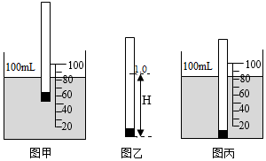
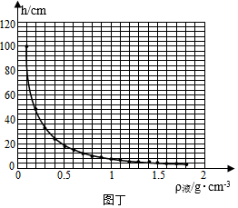

# Physics - 题目 719

**ID**: 722f59bc33344fa79f0feba29873de26
**年级**: Grade 9
**难度**: Medium-Hard
**题型**: Experiment

## 题目
小华参加综合实践活动课程，她选择了奶茶吸管、小铁钉、蜡、记号笔、刻度尺、烧杯和水，准备动手制作一只简易的密度计，她的制作步骤如下：①她在吸管的下端塞上一些小铁钉，用蜡将底部密封并保持平整，放到装有水的烧杯中，如图甲所示；②用记号笔在吸管的液面处标上记号即为水的密度；取出吸管并在记号处写上1.0，并测出该记号处到吸管底端的距离H，如图乙所示；③根据漂浮原理，密度计漂浮在其他液体中浸入的深度h会随液体密度ρ_{液}的改变而改变，所以可以利用表达式h＝（用ρ_{水}、ρ_{液}、H表示）进行标度；(1)步骤①中“塞上一些小铁钉，并用蜡将其密封”是为了使吸管在水面上，小华第一次完成该步骤时，吸管碰到了烧杯的底部，如图丙，则她应该；(2)小华画出密度计浸入液体的深度h随液体密度ρ_{液}变化的函数图象（如图丁所示），发现她所制作的简易密度计的刻度线分布（选填“均匀”或“不均匀”），刻度值由上而下逐渐（选填“变大”或“变小”）；(3)小华把她制作的简易的密度计放入某未知液体中，液面正好在1.0和1.1的中间，则该未知液体的密度（选填“大于”、“小于”或者“等于”）1.05；(4)小华在与其他同学交流时，发现大家选择的吸管一样，但放入的铁钉数量不同。​​​​​​​‌通过比较发现：放入铁钉数量（选填“多”或“少”）的那根密度计，刻度分布比较疏（所用的封蜡质量不计）。

## 解答

1. [1]当密度计漂浮在水面上时
2. V_{排}=SH
3. F_{浮}=G_{物}
4. ρ_{水}gV_{排水}=G_{物}
5. ρ_{水}gSH=G_{物}
6. 当密度计漂浮在密度为ρ_{液}的液体中时
7. V_{排液}=Sh
8. F_{浮液}=G_{物}
9. ρ_{液}gV_{排液}=G_{物}
10. ρ_{液}gSh=G_{物}
11. 所以
12. ρ_{液}gSh=ρ_{水}gSH
13. $h=\frac {ρ{{}_{水}}}{ρ{{}_{液}}}H$
14. (1)[2]为了使吸管竖直漂浮在水面上，在吸管的下端塞上小铁钉，用蜡将底部密封并保持平整。
15. [3]由图丙可知，吸管碰到了烧杯的底部，说明小铁钉的质量较大，减少小铁钉的质量，减小小铁钉的数量。
16. (2)[4][5]由图像可知，h和ρ_{液}是反比例函数，所以，刻度分布不是均匀的；刻度值由上而下逐渐变大。
17. (3)[6]根据图象可知，密度值越大，相邻刻度线之间的距离越小，液面正好在1.0和1.1的中间，则该未知液体的密度小于1.05。
18. (4)[7]由 $h=\frac {ρ{{}_{水}}}{ρ{{}_{液}}}H$ 可知，当铁钉数量较多时，H较大，液体的密度相同时， $\frac {ρ{{}_{水}}}{ρ{{}_{液}}}$ 不变，所以h变大，刻度分布比较疏。

## 知识点

**中文**:
  - 密度计的原理及应用

**English**:
  - Principle and Application of Hydrometer

---
