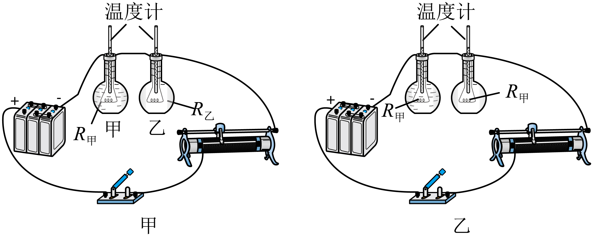

# Physics - 题目 2718

**ID**: 72bbc506bb5842c4ac2ebdc2193b3105
**年级**: Grade 9
**难度**: Medium-Hard
**题型**: Experiment

## 题目
由于水的比热容已知，为了测量某液体的比热容，小明设计了如图所示的甲和乙的电路图，图中发热丝电阻R甲>R乙，实验过程电阻产生的热量均只有80%被两种液体吸收。​​​​​​​‌（1）要使相同时间内水与未知液体吸收相同的热量，应选用（选填“甲”或“乙”）图装置，依据是；（2）通电前，烧瓶中加入初温同为t0的水和某液体，且m水<m液，通电一段时间后，分别读出温度计的示数为t水、t液，请写出该液体的比热容的表达式c液=；（水的比热容为c水，用题目已知的物理量表示）（3）在第（2）问的前提下，通电一段时间后t水<t液，是否可判断水与液体的比热容大小关系，判断依据是。

## 解答

1. （1）[1][2]实验中，要保障相同时间内水与未知液体吸收相同的热量，使两个电热丝串联，且电阻相同，由 $Q=I{^{2}}Rt$ 可知，串联电路通过它们的电流与通电时间相同，所以两个电阻丝产生的热量相同，又因为该热量的80%都被两种液体吸收，所以两液体吸热相同，应选乙图装置。
2. （2）[3]水的初温是t0，末温是t水，所以水吸收的热量为
3. Q水=c水m水(t水-t0)
4. 又因为液体吸收的热量与水吸收的热量相同，即可得Q液=Q水，所以根据公式 $Q=cm\vartriangle t$ 可得液体的比热容
5. $c{{}_{液}}=\frac {Q{{}_{液}}}{m{{}_{液}}(t{{}_{液}}-t{{}_{0}})}{\rm{=}}\frac {Q{{}_{水}}}{m{{}_{液}}(t{{}_{液}}-t{{}_{0}})}=\frac {c{{}_{水}}m{{}_{水}}(t{{}_{水}}-t{{}_{0}})}{m{{}_{液}}(t{{}_{液}}-t{{}_{0}})}=\frac {c{{}_{水}}m{{}_{水}}(t{{}_{水}}-t{{}_{0}})}{m{{}_{液}}(t{{}_{液}}-t{{}_{0}})}$
6. （3）[4][5]可判断水与液体的比热容大小关系，因为 $c{{}_{液}}=\frac {c{{}_{水}}m{{}_{水}}(t{{}_{水}}-t{{}_{0}})}{m{{}_{液}}(t{{}_{液}}-t{{}_{0}})}$ ，
7. m水<m液，t水<t液
8. 即
9. t水-t0<t液-t0
10. 所以
11. $\frac {m{{}_{水}}}{m{{}_{液}}}<1$ ， $\frac {t{{}_{水}}-t{{}_{0}}}{t{{}_{液}}-t{{}_{0}}}<1$
12. 因此可得
13. $c{{}_{液}}=\frac {c{{}_{水}}m{{}_{水}}(t{{}_{水}}-t{{}_{0}})}{m{{}_{液}}(t{{}_{液}}-t{{}_{0}})}<c{{}_{水}}$

## 知识点

**中文**:
  - 物质的比热容探究实验

**English**:
  - Experiment: Investigating Specific Heat Capacity

---
