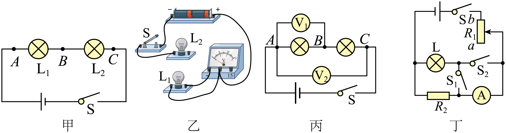

# Physics - 题目 2990

**ID**: 73f4c10df8f0408d8c7406ea58e1821a
**年级**: Grade 9
**难度**: Medium-Hard
**题型**: Experiment

## 题目
同学们进行电学实验：（一）第一组进行“探究串联电路电压特点”的实验。​​​​​​​‌所用器有：电压为 3V 的电源，一个开关，两只灯泡（L_{1}和L_{2}），两只相同电压表V_{1}和V_{2}（量程均为0~3V和0~15V），导线若干。（1）他们按图甲所示的电路图连接电路，用一只电压表分别测AB、BC、AC间的电压。每次拆接电压表时，开关应处于状态；（2）为测量L_{1}两端电压，请在图乙中用笔画线代替导线将实物图连接完整；（3）小华改用两只电压表同时进行测量。她按照图丙所示电路图连接好电路，闭合开关，发现两只电压表的指针偏转角度相同，此时电压表V_{1}和V_{2}的示数分别为V和V；（4）选择合适量程后，小华测出了AB间和AC间的电压，为了测量BC间的电压，断开开关，接下来可以；

## 解答

1. （1）为了保护电路，每次拆、接电压表时，开关应处于断开状态。
2. （2）为了测量L_{1}两端电压，电压表应并联在L_{1}两端，电流从电压表正接线柱流入，从负接线柱流出，如图所示：
3. 
4. （3）由图丙可知，电压表V_{1}测的是L_{1}两端电压，V_{2}测量的是L_{1}和L_{2}的总电压，即电源电压，因此V_{2}的示数为3V，大量程的示数为小量程的5倍，因此V_{1}的示数为0.6V。
5. （4）测量BC之间的电压，电流应从正接线柱流入，负接线柱流出，因此应保持C接线柱不动，将V_{2}连线由A接到B，若保持B接线不动，将电压表连线由A改接到C，则电压表的正负接线柱接反。
6. （5）闭合开关S、S_{2}，断开开关 S_{1}，R_{2}与灯泡L并联之后，与滑动变阻器串联，电流表测量通过定值电阻的电流，移动滑动变阻器的滑片，使电流表示数为 $\frac {U{{}_{额}}}{R{{}_{2}}}$ ，此时灯泡正常发光。
7. （7）闭合开关S、S_{1}，断开S_{2}，保持滑动变阻器滑片位置不变，此时R_{2}与灯泡L并联之后，与滑动变阻器串联，电流表测量干路电流，此时电流表示数为I，此时灯泡仍然正常发光，则通过灯泡的电流为 $I{{}_{额}}=I-\frac {U{{}_{额}}}{R{{}_{2}}}$ ，小灯泡额定功率的表达式为 $P=U{{}_{额}}I{{}_{额}}=U{{}_{额}}\times \left ({I-\frac {U{{}_{额}}}{R{{}_{2}}}}\right )$

## 知识点

**中文**:
  - 其他方法测量小灯泡的电功率
  - 探究串、并联电路中的电压规律实验

**English**:
  - Other Methods for Measuring Bulb Power
  - Experiment: Voltage Laws in Series/Parallel

---
