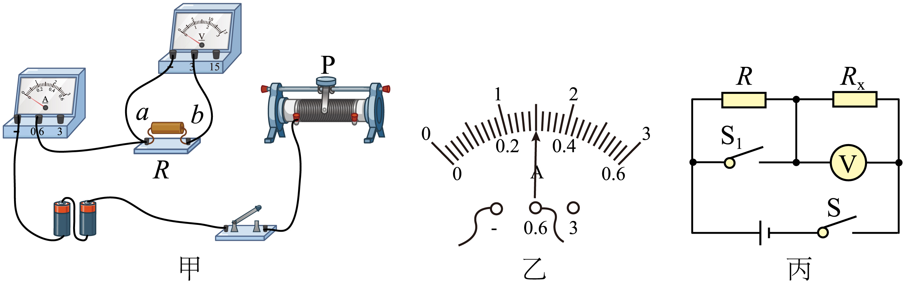

# Physics - 题目 925

**ID**: 752d6a2482c04c2baf33fa58d96bb1bc
**年级**: Grade 9
**难度**: Medium-Hard
**题型**: Experiment

## 题目
图甲是用伏安法测未知电阻R的实验图。​​​​​​​‌（1）请用笔画线代替导线，将图甲中实物电路连接完整；(      )（2）闭合开关，将滑片P向左滑动时，此时电压表示数为 $1.2{\rm{V}}$ ，电流表示数如图乙所示，其读数为I=A，则未知电阻R=Ω，要多次测量，滑动变阻器在此实验中的作用是；（3）该同学又设计了如图丙所示的测量电路，同样可以测量未知电阻，其中R是定值电阻。请在空格内把实验步骤补充完整；①，用电压表测出电源的电压U；②，用电压表测出待测电阻Rx两端的电压为U1；③请用测量值U和U1，已知量R来表达Rx=。

## 解答

1. （1）[1]伏安法测未知电阻阻值时需测量未知电阻的电压和电流大小，且电路中需串联滑动变阻器，便于调节电路中电流大小，连接滑动变阻器时接线应一上一下连接，如图所示
2. 
3. （2）[2]由乙图可知电流表量程为0~0.6A，读数时读刻度盘下侧数值，读数可得电流表示数为I=0.3A。
4. [3]未知电阻的电压U=1.2V，电流I=0.3A，由欧姆定律 $I=\frac {U}{R}$ 可知未知电阻的阻值大小为
5. $R=\frac {U}{I}=\frac {{\rm{1}}{\rm{.}}{\rm{2}}{\rm{V}}}{{\rm{0}}{\rm{.}}{\rm{3}}{\rm{A}}}{\rm{=}}{\rm{4}}Ω$
6. [4]根据串联分压可知，移动滑动变阻器滑片使滑动变阻器接入电路中的阻值变化时电路中的电流和电压分配均发生变化，可调节未知电阻R的电压，多次测量取平均值，减小误差。
7. （3）[5]闭合开关S、S1，此时电阻R被短路，电路为Rx的简单电路，且电压表测量的是Rx的电压，电压表示数即为电源电压。
8. [6]闭合开关S，断开开关S1，此时电阻R与电阻Rx串联接入电路，电压表测量Rx的电压。
9. [7]闭合开关S，断开开关S1时，由串联分压可知电阻R两端的电压为
10. UR=U-U1
11. 可知此时电路中的电流大小为
12. $I=\frac {U{{}_{R}}}{R}=\frac {U-U{{}_{1}}}{R}$
13. 则Rx的阻值大小为
14. $R{{}_{{\rm{x}}}}=\frac {U{{}_{1}}}{I}=\frac {U{{}_{1}}}{\frac {U-U{{}_{1}}}{R}}=\frac {U{{}_{1}}R}{U-U{{}_{1}}}$

## 知识点

**中文**:
  - 伏安法测电阻的探究实验
  - 其他方法测电阻

**English**:
  - Experiment: Measuring Resistance (Voltammetry)
  - Other Methods for Measuring Resistance

---
