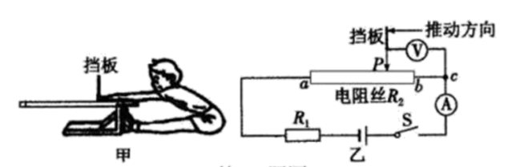

# Physics - 题目 2738

**ID**: 7595cbf837164d3fbb99d85bc4c8edb9
**年级**: Grade 9
**难度**: Medium-Hard
**题型**: Experiment

## 题目
如图甲所示是坐位体前屈的测试仪，测试时需要从刻度尺上读数，为了在家中有效练习这一项目，小致在家设计了如图乙所示的测量坐位体前屈成绩的装置，他将电表的表盘进行了改装，其中R_{1}是一个阻值为40Ω的电阻丝，用电阻丝R_{2}制成一个滑动变阻器，最大阻值为20Ω，研究过程中，经过调试将挡板位于b点的位置确定为0刻度，他发现当P位于a点时，电压表示数为2V，将电压表的刻度改为对应测量的距离。​​​​​​​‌(1)滑片在b点时，闭合开关，电压表示数等于电源电压，电流表没有示数，由此可以判断电路故障是；(2)排除故障后，小致利用这个测量仪进行练习，练习的过程中他发现该器材还可以探究导体电阻的大小与的关系；(3)小致制作的测量仪是用电压表改装而成的，它的刻度是（选填“均匀的”或“不均匀”）的；(4)经过一段时间的练习之后，小致的坐位体前屈成绩已经达到最大测量值，为了满足进一步练习的需要，他要把测量最大值提高到原来的1.5倍，但是不想改变原来仪表的分度值，他找到了材料和横截面积与R_{2}相同，长度是它的1.5倍的电阻丝 $R{{}_{2}}{^{^{′}}}$ 替换R_{2}，为了达到目的他还需要将R_{1}截掉原长的；(5)当达到最大测量值时，改进前后的器材相比，电路的总功率之比为。

## 解答

1. (1)[1]滑片在b点时，闭合开关，电压表示数等于电源电压，电流表没有示数，可能是bc间断路，使电压表串联在电路中，电压表阻值过大，使得电流过小，且电压表示数接近电源电压。
2. (2)[2]通过改变电阻丝接入电路中的长度，观察电流表示数的变化，可以探究导体电阻的大小与导体长度的关系。
3. (3)[3]因为电路中的总电阻是不变的，电源电压一定，由 $I=\frac {U}{R}$ 可知，电流是不变的，所以电压表的示数与电压表并联部分的电阻成正比，因为制作的测量仪是用电压表改装而成的，所以它的刻度是均匀的。
4. (4)[4]当P位于a点时，电压表示数为2V，R_{1}是一个阻值为40Ω的电阻丝，R_{2}最大阻值为20Ω，可得电源电压
5. $U=U{{}_{1}}+U{{}_{2}}=\frac {U{{}_{2}}}{R{{}_{2}}}\times R{{}_{1}}+U{{}_{2}}=\frac {{\rm{2}}{\rm{V}}}{{\rm{2}}{\rm{0}}{\rm{Ω}}}\times {\rm{4}}{\rm{0}}{\rm{Ω}}+{\rm{2}}{\rm{V}}{\rm{=}}{\rm{6}}{\rm{V}}$
6. 测量最大值提高到原来的1.5倍，当P位于a点时，电压表示数最大，原来的最大电压为2V，所以改变后的电压表电压应为3V，材料和横截面积与R_{2}相同，长度是它的1.5倍的电阻丝，其最大阻值为R_{2}的1.5倍，R_{2}的最大阻值为20Ω，所以 $R{{}_{2}}{^{^{′}}}$ 的最大阻值为30Ω，改装后的电源电压
7. $U=U{{}_{1}}{^{^{′}}}+U{{}_{2}}{^{^{′}}}=\frac {U{{}_{2}}{^{^{′}}}}{R{{}_{2}}{^{^{′}}}}\times R{{}_{1}}{^{^{′}}}+U{{}_{2}}{^{^{′}}}{\rm{=}}\frac {{\rm{3}}{\rm{V}}}{{\rm{3}}{\rm{0}}{\rm{Ω}}}\times R{{}_{1}}{^{^{′}}}+{\rm{3}}{\rm{V}}$
8. 因为电源电压不变，故可解得 $R{{}_{1}}{^{^{′}}}{\rm{=}}{\rm{3}}{\rm{0}}{\rm{Ω}}$ ，因为R_{1}的阻值是40Ω，为了达到目的他还需要将R_{1}截掉原长的 $\frac {1}{4}$ 。
9. (5)[5]当达到最大测量值时，改进前后的器材相比，电路的总功率之比为
10. $\frac {P{{}_{前}}}{P{{}_{后}}}=\frac {\frac {U{^{2}}}{R{{}_{1}}+R{{}_{2}}}}{\frac {U{^{2}}}{R{{}_{1}}{^{^{′}}}+R{{}_{2}}{^{^{′}}}}}=\frac {R{{}_{1}}{^{^{′}}}+R{{}_{2}}{^{^{′}}}}{R{{}_{1}}+R{{}_{2}}}=\frac {{\rm{3}}{\rm{0}}{\rm{Ω}}+{\rm{3}}{\rm{0}}{\rm{Ω}}}{{\rm{4}}{\rm{0}}{\rm{Ω}}+{\rm{2}}{\rm{0}}{\rm{Ω}}}{\rm{=}}\frac {{\rm{1}}}{{\rm{1}}}$

## 知识点

**中文**:
  - 电流表与电压表的改装

**English**:
  - Modification of Ammeters and Voltmeters

---
