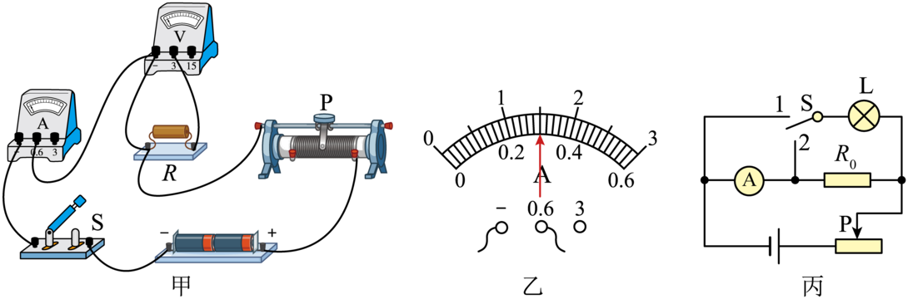

# Physics - 题目 2669

**ID**: 7919eb90d51243a5b5e751608bb48d9a
**年级**: Grade 9
**难度**: Medium-Hard
**题型**: Experiment

## 题目
在“测量未知电阻R的电阻”实验中，小南设计了如图甲所示的实验电路。​​​​​​​‌（1）本实验的实验原理是，实验中滑动变阻器除了有改变待测电阻R两端电压的作用以外还可以起到的作用；（2）图甲是小南连接的电路，其中有一根导线连接有误，请在该导线上打“×”，并在原图上用笔画线代替导线画出正确的连线（只连一根，导线不能交叉）；（3）小南改正接线后继续进行实验，开关闭合前应将滑片P移到最（选填“左”或“右”）端．闭合开关后发现电流表有示数、电压表无示数，若故障只发生在电阻R或滑动变阻器上，则故障可能是；（4）排除故障后，闭合开关S，移动滑片P将电压表调到合适的值，如图乙此时电流表示数为A；（5）利用本次实验器材还可以做（选填“A”或“B”）的实验。

## 解答

1. （1）根据欧姆定律，本实验的实验原理是 $R=\frac {U}{I}$ ；实验中滑动变阻器除了有改变待测电阻R两端电压的作用（达到多次测量的目的）以外还可以起到保护电路的作用。
2. （2）图甲是小南连接的电路中电阻R和电压表短路了，电阻应与变阻器串联，电压表与电阻并联，正确的连线如下所示：
3. 
4. （3）小南改正接线后继续进行实验，开关闭合前应将滑片P移到阻值最大处，即最左端；闭合开关后发现电流表有示数，可知电路为通路，电压表无示数，若故障只发生在电阻R或滑动变阻器上，则故障可能是R短路,导致电压表与导线并联。
5. （4）排除故障后，闭合开关S，移动滑片P将电压表调到合适的值，如图乙所示，电流表选用小量程，分度值为0.02A，此时电流表示数为0.3A。
6. （5）电流与电阻和电压大小有关，研究电流与其中一个因素的关系时，要控制另外一个因素不变，因题中只有一个定值电阻，故利用本次实验器材还可以做研究探究电流与电压的关系，
7. （6）分析①中电路的连接及电流表测量的电流，根据欧姆定律和根据并联电路电压的规律，可知灯正常发光；在②中分析电路的连接及电流表测量的电流，根据已知条件和并联电路电流的规律求出灯的额定电流，根据欧姆定律得出小灯泡正常工作时的电阻。
8. ③在①中，灯与定值电阻并联后再与变阻器串联，电流表测定值电阻的电流，调节滑片P，使电流表的示数为 $\frac {U{{}_{0}}}{R{{}_{0}}}$ ，根据欧姆定律，定值电阻的电压为 $U{{}_{0}}$ ，根据并联电路电压的规律，灯的电压为 $U{{}_{0}}$ ，灯正常发光；在②中，电路的连接关系没有改变，各电阻大小和通过的电流没有改变，电流表测灯与定值电阻的电流，灯仍正常发光，根据并联电路电流的规律，灯的额定电流为 $I{{}_{额}}=I-\frac {U{{}_{0}}}{R{{}_{0}}}$
9. 由欧姆定律可得出灯正常发光的电阻为 $R{{}_{{\rm{L}}}}=\frac {U{{}_{0}}}{I-\frac {U{{}_{0}}}{R{{}_{0}}}}=\frac {U{{}_{0}}R{{}_{0}}}{IR{{}_{0}}-U{{}_{0}}}$

## 知识点

**中文**:
  - 伏安法测电阻的探究实验
  - 其他方法测电阻

**English**:
  - Experiment: Measuring Resistance (Voltammetry)
  - Other Methods for Measuring Resistance

---
