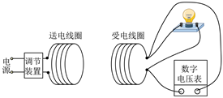
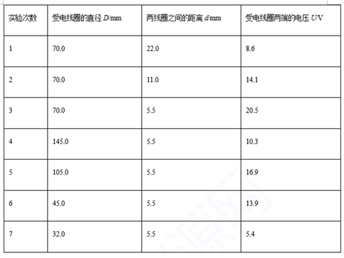

# Physics - 题目 296

**ID**: 7939f0aa48734f90a2aeeea9d95208b3
**年级**: Grade 9
**难度**: Medium-Hard
**题型**: Experiment

## 题目
如图是科技小组的同学利用电磁转换的知识制作的“电能无线传输”装置的示意图｡图中送电线圈利用电流产生磁场，受电线圈利用磁场产生电流｡受电线圈正对并靠近送电线圈可以产生电流，使灯泡发光，实现电能的无线传输｡(1)送电线圈是利用电流的效应工作的，与受电线圈产生电流的原理相同的是；（选填“电动机”或“发电机”）(2)受电线圈中电流大小可以通过灯泡来反映；(3)在图中的电源、调节装置和送电线圈不改变的情况下，该小组同学想探究影响受电线圈两端电压大小的因素，猜想它可能与受电线圈的匝数、直径及两线圈之间的距离有关。​​​​​​​‌通过查阅资料，他们了解到了受电线圈两端电压与线圈匝数的关系。接着他们用相同规格的漆包线绕制了多个匝数相同、直径不同的线圈，对其余两个猜想进行探究。实验数据如下表：（送电线圈直径为70.0mm）①分析三次实验数据可初步得出结论：在受电线圈的直径和匝数相同时，两线圈之间的距离越小，受电线圈两端的电压越大；②分析3､4､5､6､7五次实验数据可初步得出结论：在两线圈之间的距离和受电线圈的匝数相同的情况下，受电线圈直径增大时，其两端电压；(4)通过实验，小组同学发现电能无线传输存在传输距离的缺点尽管如此，电能无线传输技术仍然有着广阔的应用前景，如部分手机和电动牙刷的无线充电

## 解答

1. (1)[1]送电线圈利用电流产生磁场，故送电线圈是利用电流的磁效应工作的。
2. [2]送电线圈的工作原理是电流的磁效应，和受电线圈产生电流的原理相同的是发电机，电动机的工作原理通电线圈受到磁场的作用。
3. (2)[3]利用转换法通过灯泡的亮度（或明暗程度､两端的电压）来反映受电线圈中电流大小。
4. (3)[4]要探究受电线圈两端电压与两个线圈之间距离的关系，需要在改变两个线圈之间距离的同时，保持受电线圈的直径等其他条件不变，所以需要分许1、2、3三次实验数据。
5. [5]3､4､5､6､7五次实验，两个线圈之间的距离不变，只改变了受电线圈的直径，所以探究的是受电线圈两端电压与受电线圈直径的关系，分析数据可以发现，在两个线圈之间距离和线圈匝数相同的情况下，受电线圈直径增大时，其两端电压先增大后减小。
6. (4)[6]通过实验可以发现，在受电线圈直径和匝数不变时，两线圈之间距离增大时，受电线圈两端电压显著减小，所以电能无线传输存在输送距离小的缺点。

## 知识点

**中文**:
  - 发电机的构造和原理
  - 电流的磁效应

**English**:
  - Structure and Principle of Generator
  - Magnetic Effect of Current

---
