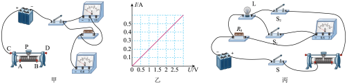

# Physics - 题目 1439

**ID**: 7949fd1d23ca4d7aa79cdd827b1b40ec
**年级**: Grade 9
**难度**: Medium-Hard
**题型**: Experiment

## 题目
在“探究电流与电压的关系”实验中（电源电压恒为6 V）。​​​​​​​‌（1）请用笔画线代替导线，将图甲中电路连接完整，要求滑片P向B端滑动时，电流表示数变大（连线时导线不允许交叉）。（2）闭合开关，移动滑动变阻器的滑片P，发现电压表始终无示数，而电流表有示数（且电压表、电流表均正常，各个连接点连接正常）。造成这个现象的原因是。（3）小明排除了电路故障，正确操作实验后，得到多组实验数据。绘制成电阻R的I-U图像，如图乙所示，由图像可得出的结论是。（4）小明继续用此电路来探究“电流与电阻的关系”，想要完成四组实验，准备好的定值电阻有5Ω、10Ω、15Ω、20Ω。先将5Ω电阻接入电路中。将电路正确连接后，闭合开关，移动变阻器的滑片P。使定值电阻两端的电压为2V，断开开关，将定值电阻换成阻值为10Ω的电阻，移动滑动变阻器的滑片，使电压表的示数仍为2V。为完成四组实验，滑动变阻器的最大电阻应不小于Ω。[拓展]小明还想测额定电压为3.8 V的灯泡L的额定功率，向老师借了一个10Ω的定值电阻R_{0}，没用电压表，也测量出了灯泡L的额定功率（如图丙），请你将下列实验过程补充完整∶①（填S、S_{1}、S_{2}的通断情况）。调节滑动变阻器的滑片使电流表示数为A；②闭合S、S_{1}，断开S_{2}，保持滑动变阻器的滑片位置不变，记录电流表的示数为I；③灯泡L额定功率的表达式P_{额}=（用你测量物理量的字母和已知量来表示）。

## 解答

1. （1）[1]滑片P向B端滑动时，电流表示数变大，即电阻变小，故变阻器右下接线柱连入电路中，根据图乙知道，电流最大为0.6 A．电流表选用小量程与电阻串联。电压表选用小量程与电阻并联。
2. 
3. （2）[2]因为电流表有示数，说明电路是通路，但电压表无示数，说明R上的电压为零，造成这个现象的原因只有一个，即电阻被短路。
4. （3）[3]绘制出电阻R的I-U图像为一过原点的直线，由图像可得出的结论是∶电阻一定时，电流与电压成正比。
5. （4）[4]根据串联电路电压的规律，变阻器分得的电压
6. U_{滑}=U-U_{v}=6V-2V=4V
7. 变阻器分得的电压为电压表示数的2倍，根据分压原理，当接入20Ω电阻时，变阻器连入电路中的电阻为
8. R_{滑}=2×20Ω=40Ω
9. 为完成此四组实验，滑动变阻器的最大电阻应不小于40Ω。
10. [拓展]①[5][6]闭合S、S_{2}，断开S_{1}，调节滑动变阻器的滑片使电流表示数为
11. $I{{}_{L}}=\frac {U{{}_{L}}}{R{{}_{0}}}=\frac {{\rm{3}}{\rm{.}}{\rm{8}}{\rm{V}}}{{\rm{1}}{\rm{0}}{\rm{Ω}}}{\rm{=}}{\rm{0}}{\rm{.}}{\rm{3}}{\rm{8}}{\rm{A}}$
12. ③[7]在②中，使电流表测灯与R_{0}并联的总电流，因电路的连接关系没有改变，各电阻的大小和通过的电流不变，灯仍正常发光，根据并联电路电流的规律，灯的额定电流
13. I_{L}=I-0.38A
14. 小灯泡L_{2}额定功率的表达式
15. P_{额}=U_{L}×I_{L}=3.8 V×（I- -0.38 A）

## 知识点

**中文**:
  - 其他方法测量小灯泡的电功率
  - 电流与电压关系的探究实验
  - 电流与电阻关系的探究实验

**English**:
  - Other Methods for Measuring Bulb Power
  - Experiment: Relationship between Current and Voltage
  - Experiment: Relationship between Current and Resistance

---
