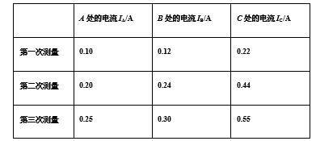
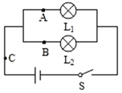

# Physics - 题目 2317

**ID**: 7997a89c40e940ee9d1c8654aa102b00
**年级**: Grade 9
**难度**: Medium-Hard
**题型**: Experiment

## 题目
探究并联电路中电流的关系，如图所示的并联电路中，流过A、B、C各处的电流之间可能有什么关系？(1)如图所示连接电路：在拆、接电路时，开关必须；把电流表分别接入到电路中的A、B、C处，测出它们的电流，填入表中；(2)为了防止偶然因素影响，我们采用以下两种方法之一，重复上面实验步骤。​​​​​​​‌方法一：改变电池的节数；方法二：更换其中一条支路中的小灯泡（其规格不同）；表格补充完整后，通过对上面数据的分析，后面两次实验是采用方法进行的。

## 解答

1. (1)[1]为了电路的安全，在拆、接电路时，开关必须断开。
2. (2)[2]观察表格中的数据可知，第二次的三个数据是第一次的2倍，第三次是第一次的2.5倍，故是通过改变电压得到的数据，所以后面两次实验是采用方法一进行的。

## 知识点

**中文**:
  - 探究串、并联电路的电流规律实验

**English**:
  - Experiment: Current Laws in Series/Parallel

---
