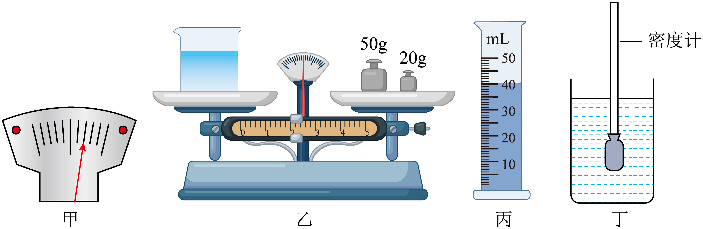

# Physics - 题目 2793

**ID**: 7a3cf1eb1f9a49bbabc5297af86a3d15
**年级**: Grade 9
**难度**: Medium-Hard
**题型**: Experiment

## 题目
“五月五，过端午”。​​​​​​​‌小渝在物理实践课上学习腌制咸鸭蛋，通过测量盐水的密度来检测所配制盐水的浓度。他用两种方法测量实验室已经配制好的盐水的密度。（1）小渝利用天平和量筒测量盐水密度：实验前，将托盘天平放在工作台上，游码移到标尺的处，指针静止在如图甲所示位置，此时应将平衡螺母向调节，使天平水平平衡。（2）将盛有适量盐水的烧杯放在天平的左盘，天平重新平衡时，右盘所加砝码及游码位置如图乙所示，烧杯和盐水的总质量为${\rm{g}}$ ；将烧杯中的盐水部分倒入量筒，观察到量筒内的液面如图丙所示，再测得此时烧杯和剩余盐水的总质量为 $26.0{\rm{g}}$ ，则配制盐水的密度为${\rm{k}}{\rm{g}}/{\rm{m}}{^{3}}$ 。将烧杯中的盐水倒入量筒时，若不慎有盐水溅出，则测出的盐水密度（选填“偏大”“偏小”或“不变”）。（3）小渝在吸管下方安装一个小瓶，将铁屑装入瓶中，制成一支简易密度计。使密度计总质量为 $22{\rm{g}}$ ，放入液体后能竖直漂浮，小瓶完全浸没，如图丁所示。放入水中静止，在密度计上标记出水面对应位置 ${\rm{M}}$ ，密度计排开水的体积为${\rm{c}}{\rm{m}}{^{3}}$ 。从水中取出擦干后，放入待测盐水中，静止时标记 ${\rm{M}}$ 比液面高 $2{\rm{c}}{\rm{m}}$ 。取出密度计擦干，倒出部分铁屑，使其总质量为 $18{\rm{g}}$ ，再放入水中，静止时标记 ${\rm{M}}$ 比水面高 $4{\rm{c}}{\rm{m}}$ ，则盐水的密度为${\rm{g}}/{\rm{c}}{\rm{m}}{^{3}}$ 。

## 解答

1. （1）根据托盘天平使用规则，实验前，将托盘天平放在水平工作台上，游码移到标尺的零刻度线处。
2. 根据指针静止时所在位置，可判定横梁左端偏高，依据“哪边高向哪调”的原则，所以此时应将平衡螺母向左调节，直到指针指在分度盘的中线处，使天平水平平衡。
3. （2）由图乙可知，右盘所加砝码的总质量为 $m{{}_{码}}={{5}}{{0}}{\rm{g}}{{+}}{{2}}{{0}}{\rm{g}}{\rm{=}}{{7}}{{0}}{\rm{g}}$
4. 游码的读数为2g，则烧杯和盐水的总质量为 $m{{}_{总}}=m{{}_{码}}+m{{}_{游}}=70{\rm{g}}+2{\rm{g}}=72{\rm{g}}$
5. 将烧杯中的盐水部分倒入量筒后，再测得此时烧杯和剩余盐水的总质量为 $26.0{\rm{g}}$ ，则倒入量筒中的盐水的质量为 $m{{}_{液}}=m{{}_{总}}-m{{}_{总}}{^{\prime }}=72{\rm{g}}-26{\rm{g}}=46{\rm{g}}$
6. 由图丙可知，倒入量筒中的盐水的体积为 $V{{}_{液}}=40{\rm{m}}{\rm{l}}=40{\rm{c}}{\rm{m}}{^{{{3}}}}$
7. 则配制盐水的密度为 $ρ{{}_{盐水}}{\rm{=}}\frac {m{{}_{液}}}{V{{}_{液}}}{\rm{=}}\frac {46{\rm{g}}}{40{\rm{c}}{\rm{m}}{^{{{3}}}}}{\rm{=}}{{1}}{{.}}{{1}}{{5}}{\rm{g}}{\rm{/}}{\rm{c}}{\rm{m}}{^{{{3}}}}{\rm{=}}{{1}}{{.}}{{1}}{{5}}\times {{1}}{{0}}{^{{{3}}}}{\rm{k}}{\rm{g}}{\rm{/}}{\rm{m}}{^{{{3}}}}$
8. 将烧杯中的盐水倒入量筒时，若不慎有盐水溅出，根据 $m{{}_{液}}=m{{}_{总}}-m{{}_{总}}{^{\prime }}$
9. 则我们得到的倒入量筒中盐水的质量 $m{{}_{液}}$ 会偏大，而量筒中倒入盐水的体积 $V{{}_{液}}$ 是准确的，所以由计算公式 $ρ{{}_{盐水}}{\rm{=}}\frac {m{{}_{液}}}{V{{}_{液}}}$ 可知，测出的盐水密度偏大。
10. （3）由题意得，简易密度计的质量为 $m{{}_{计}}=22{\rm{g}}=0.022{\rm{k}}{\rm{g}}$
11. 则该密度计的重力为 $G{{}_{计}}=m{{}_{计}}g=0.022{\rm{k}}{\rm{g}}\times 10{\rm{N}}{\rm{/}}{\rm{k}}{\rm{g}}=0.22{\rm{N}}$
12. 因为密度计放入液体竖直漂浮，所以由物体的浮沉条件可得密度计所受浮力为 $F{{}_{浮}}=G{{}_{计}}=0.22{\rm{N}}$
13. 根据阿基米德原理可得，密度计排开水的体积为 $V{{}_{排}}=\frac {F{{}_{浮}}}{ρ{{}_{水}}g}=\frac {0.22{\rm{N}}}{1.0\times 10{^{3}}{\rm{k}}{\rm{g}}{\rm{/}}{\rm{m}}{^{{{3}}}}\times 10{\rm{N}}{\rm{/}}{\rm{k}}{\rm{g}}}=0.22\times 10{^{-4}}{\rm{m}}{^{{{3}}}}=22{\rm{c}}{\rm{m}}{^{{{3}}}}$
14. 设吸管的横截面积为S_{0}，由阿基米德原理推理可得当物体漂浮时 $m{{}_{物}}=m{{}_{排}}=ρ{{}_{液}}V{{}_{排}}$
15. 已知将密度计放入待测盐水中，静止时标记 ${\rm{M}}$ 比液面高 $2{\rm{c}}{\rm{m}}$ ，由此可得关系式 $ρ{{}_{盐水}}\left ({22{\rm{c}}{\rm{m}}{^{{{3}}}}-S{{}_{0}}\cdot 2{\rm{c}}{\rm{m}}}\right )=22{\rm{g}}$ ①
16. 将密度计倒出部分铁屑，使其总质量为 $18{\rm{g}}$ ，再放入水中，静止时标记 ${\rm{M}}$ 比水面高 $4{\rm{c}}{\rm{m}}$ ，由此可得关系式 $ρ{{}_{水}}\left ({22{\rm{c}}{\rm{m}}{^{{{3}}}}-S{{}_{0}}\cdot 4{\rm{c}}{\rm{m}}}\right )=18{\rm{g}}$ ②
17. 联立①②两式可解得 $S{{}_{0}}=1{\rm{c}}{\rm{m}}{^{{{2}}}},ρ{{}_{盐水}}=1.1{\rm{g}}{\rm{/}}{\rm{c}}{\rm{m}}{^{{{3}}}}$
18. 所以盐水的密度为 ${{1}}{{.}}{{1}}{\rm{g}}{\rm{/}}{\rm{c}}{\rm{m}}{^{{{3}}}}$ 。

## 知识点

**中文**:
  - 利用浮力知识测密度
  - 液体密度的测量实验

**English**:
  - Measuring Density using Buoyancy
  - Experiment: Measuring Density of Liquids

---
