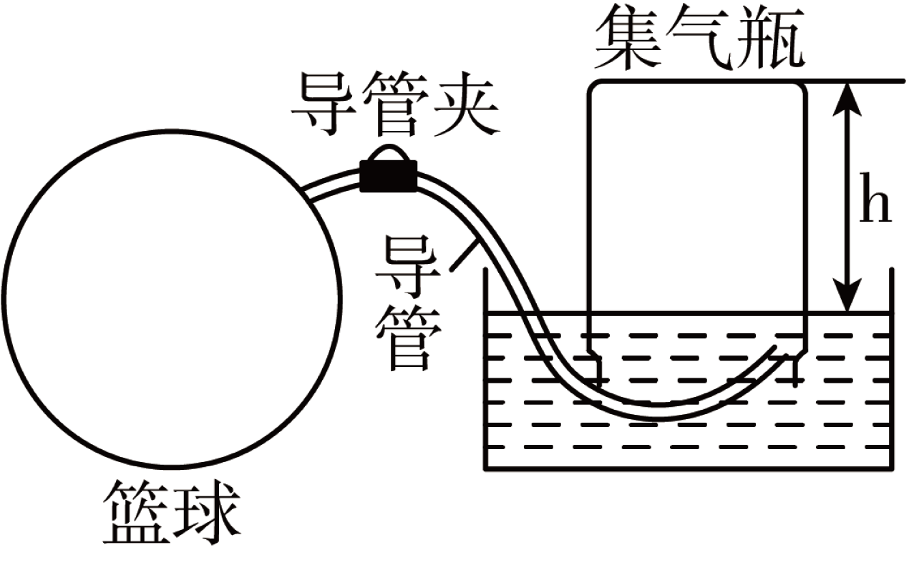

# Physics - 题目 705

**ID**: 7c718e496389446090a843d56cff7d21
**年级**: Grade 9
**难度**: Medium-Hard
**题型**: Experiment

## 题目
用“排水集气法”测量空气密度。​​​​​​​‌主要的实验步骤如下：①用电子天平测出打足了气的篮球质量m1；②测量出集气瓶的内径并算出其内部横截面积S；③集气瓶装满水，口朝下放在水槽内，带夹导管一端连接篮球的气嘴，另一端放在瓶内，准备排水集气；④轻轻松开导管夹，让篮球内的空气进入集气瓶，在篮球体积没有明显减小前，停止放气；⑤测出放气后篮球的质量m2；⑥调整瓶的高度，使瓶外水面相平，测量瓶内空气柱的高度h；⑦利用密度公式算出集气瓶内空气密度。（1）篮球在放气过程中，球内空气质量，空气密度；（选填“减小”或“不变” ）（2）若瓶内水面明显高于水槽内水面，需要缓慢地（选填“向上提”或“向下压” ）集气瓶，直至瓶内外水面相平；（3）空气密度ρ=；（用所测物理量表示）（4）实验中要求篮球体积不发生明显变化，是为了减小（选填“重力”或“浮力” ）对质量测量的影响。

## 解答

1. （1）[1][2]篮球在放气过程中，球内气体被放出，所以球内空气质量减小，篮球体积不变，根据 $ρ=\frac {m}{V}$ 知，质量减小，体积不变，空气密度减小。
2. （2）[3]若瓶内水面明显高于水槽内水面，说明里面的气压小于外界大气压，需要缓慢地向下压集气瓶，使一定质量的气体体积变小，气压变大，直至瓶内外水面相平。
3. （3）[4]原来球和气体的总质量为m1，排出空气后，剩余气体与篮球的总质量为m2，则排出空气的质量为
4. m=m1-m2
5. 排出空气的体积
6. V=Sh
7. 则空气的密度为
8. $ρ=\frac {m}{V}=\frac {m{{}_{1}}-m{{}_{2}}}{Sh}$
9. （4）[5]根据F浮=ρ气gV知，实验中要求篮球体积不发生明显变化，是为了减小浮力对质量测量的影响。

## 知识点

**中文**:
  - 特殊方法测密度

**English**:
  - Special Methods for Measuring Density

---
