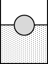

# Physics - 题目 2597

**ID**: 82e07e5820b5406a936e90e4fed51a54
**年级**: Grade 9
**难度**: Medium-Hard
**题型**: Experiment

## 题目
小明做“小球浸入液体中的体积V_{浸}与哪些因素有关”的实验，他选取了体积相同、密度不同的若干小球放入水中（水深大于小球直径），如图所示，测出小球浸入水中的体积V_{浸}，并将相关数据记录在表一中。​​​​​​​‌表一（ρ_{水}＝1.0×10^{3}千克/米^{3}）实验序号12345ρ_{球}（×10^{3}千克/米^{3}）0.30.60.81.01.2V_{浸}（×10^{-3}米^{3}）0.300.600.801.001.00①分析比较表一中实验序号中的数据及相关条件可知：浸入水中体积相同的小球，当ρ_{球}与ρ_{水}的大小满足关系时，V_{浸}与ρ_{球}无关。②分析比较表一中实验序号1~3中V_{浸}与ρ_{球}的数据及相关条件可知：浸入水中的小球，当时，。③小红选取了体积相同、密度不同的若干小球放入酒精中（酒精深度大于小球直径）重复小明的实验，表二（ρ_{酒}＝0.8×10^{3}千克/米^{3}）实验序号678910ρ_{球}（×10^{3}千克/米^{3}）0.10.30.50.70.9V_{浸}（×10^{-3}米^{3}）0.250.751.251.75并将实验数据记录在表二中。实验序号10中的数据为。

## 解答

1. [1][2]从表中可以看到，浸入水中体积相同的小球只有实验序号4与5，并且看到， $ρ{{}_{球}}\geqslant ρ{{}_{水}}$ ， $ρ{{}_{球}}$ 的大小在变化，但是 $V{{}_{浸}}$ 没有发生变化，这说明了浸入水中体积相同的小球，当 $ρ{{}_{球}}$ 与 $ρ{{}_{水}}$  的大小满足 $ρ{{}_{球}}\geqslant ρ{{}_{水}}$ 关系时， $V{{}_{浸}}$ 与 $ρ{{}_{球}}$ 无关；
2. [3][4]从实验序号1~3可知， $ρ{{}_{球}}$ 都是小于 $ρ{{}_{水}}$ 的，并且这三个小球体积相等， $ρ{{}_{球}}$ 与 $V{{}_{浸}}$ 的比值都是等于1，即 $ρ{{}_{球}}$ 与 $V{{}_{浸}}$ 成正比，所以说当小球体积相同且 $ρ{{}_{球}}\leqslant ρ{{}_{水}}$ 时， $ρ{{}_{球}}$ 与 $V{{}_{浸}}$ 成正比；
3. [5]由上述可知，当小球体积相同且 $ρ{{}_{球}}\leqslant ρ{{}_{酒}}$ ， $ρ{{}_{球}}$ 与 $V{{}_{浸}}$ 成正比，所以当 $ρ{{}_{球}}=ρ{{}_{酒}}$ 时，小球浸入酒精中的体积符合关系式
4. $\frac {0.7\times 10{^{3}}{\rm{k}}{\rm{g}}{\rm{/}}{\rm{m}}{^{{\rm{3}}}}}{1.75\times {\rm{1}}{\rm{0}}{^{{\rm{-}}{\rm{3}}}}{\rm{m}}{^{{\rm{3}}}}}=\frac {ρ{{}_{球}}}{V{{}_{浸}}}=\frac {0.8\times {\rm{1}}{\rm{0}}{^{{\rm{3}}}}{\rm{k}}{\rm{g}}{\rm{/}}{\rm{m}}{^{{\rm{3}}}}}{V{{}_{浸}}}$
5. 可解得 $V{{}_{浸}}=2\times 1{\rm{0}}{^{{\rm{-}}{\rm{3}}}}{\rm{m}}{^{{\rm{3}}}}$ ，还可以知道，当 $ρ{{}_{球}}$ 与 $ρ{{}_{酒}}$ 的大小满足 $ρ{{}_{球}}\geqslant ρ{{}_{酒}}$ 时， $V{{}_{浸}}$ 与 $ρ{{}_{球}}$ 无关，即实验序号10中的数据为2.00。

## 知识点

**中文**:
  - 实验探究物体的浮沉条件

**English**:
  - Experiment: Investigating Floating/Sinking Conditions

---
