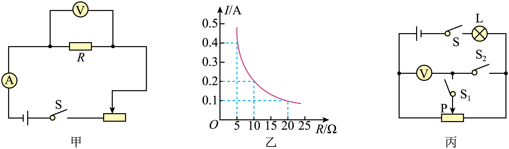

# Physics - 题目 2972

**ID**: 830b90a065ef4a49b5a31868cd3ee8c0
**年级**: Grade 9
**难度**: Medium-Hard
**题型**: Experiment

## 题目
小理同学利用以下器材探究“电流与电阻的关系”：电源电压为6V，电流表 $\left ({0\sim 0.6{\rm{A}}}\right )$ 、电压表 $\left ({0\sim 3{\rm{V}}}\right )$ 、定值电阻（5Ω、10Ω、20Ω各一个）、开关、滑动变阻器“25Ω　1A”和导线若干。​​​​​​​‌（1）连接电路时，开关应，且应将滑动变阻器的滑片移到最端；（2）当接入的电阻R为5Ω时，闭合开关，电流表无示数，电压表示数很大，移动滑片，两表指针保持不动，若电路中只有一处故障，则故障是；（3）排除故障后进行如下操作：①闭合开关，记录电流表示数；②移动滑片使电压表示数为U_{0}时，记录电流表示数；③当接入的电阻R为10Ω时，闭合开关，重复步骤②；④当接入的电阻R为20Ω时，闭合开关，电压表示数大于U_{0}，为了完成此次实验，滑动变阻器的最大阻值不得小于Ω，更换滑动变阻器后利用测得的数据绘制出如图乙所示的图像，由图像得出当导体两端的电压不变时，通过导体的电流与导体的电阻成；（4）在图乙中，定值电阻的阻值为5Ω和20Ω时，滑动变阻器的电功率分别为P_{1}和P_{2}，则P_{1}：P_{2}=；（5）完成上述实验后，小致又利用原实验器材，设计了如图丙所示的电路，测出了额定电压为2.5V的小灯泡的额定功率，请帮他将实验步骤补充完整：①闭合开关S、S_{1}和S_{2}，调节滑动变阻器的滑片，使电压表示数为V时，小灯泡正常发光；②闭合开关S、S_{1}，断开S_{2}，保持滑片位置不变，读出电压表示数为2V；③闭合开关S、S_{2}，断开S_{1}，读出电压表的示数为4V；④小灯泡的额定功率为W。

## 解答

1. （1）为保护电路，连接电路时，开关应处于断开状态。闭合开关前，应将滑动变阻器的滑片移至阻值的最大处，即最右端。
2. （2）闭合开关，移动滑片P，电流表示数为零，说明电路可能断路，电压表示数很大，说明电压表和电源的两极是通路，与电压表并联部分断路，可能定值电阻R断路。
3. （3）由图像可知，定值电阻两端的电压保持不变， $U{{}_{{\rm{V}}}}=I{{}_{1}}R{{}_{1}}=0.4{\rm{A}}\times 5{\rm{Ω}}=2{\rm{V}}$ ，根据串联电路电压的规律知，滑动变阻器两端的电压 $U{{}_{滑}}=U-U{{}_{{\rm{V}}}}=6{\rm{V}}-2{\rm{V}}=4{\rm{V}}$ ，根据串联电路的分压可得 $\frac {U{{}_{{\rm{V}}}}}{U{{}_{滑}}}=\frac {R}{R{{}_{滑}}}$ ，当接入的电阻R为20Ω时，滑动电阻器接入电路的阻值为 $R{{}_{滑}}=\frac {U{{}_{滑}}R}{U{{}_{{\rm{V}}}}}=\frac {4{\rm{V}}\times 20{\rm{Ω}}}{2{\rm{V}}}=40{\rm{Ω}}$ ，则为了完成此次实验，滑动变阻器的最大阻值不得小于40Ω。由图乙可知，电流和电阻的乘积不变，即电压表的示数不变，可以得到当电压一定时，遇过导体的电流与导体的电阻成反比。
4. （4）定值电阻和变阻器串联，串联电路中各处的电流相等，由图乙可知，当定值电阻阻值为R_{1}=5Ω时，通过滑动变阻器的电流 $I{{}_{滑}}=I{{}_{1}}=0.4{\rm{A}}$ ，当定值电阻阻值为R_{2}=20Ω时，通过滑动变阻器的电流 $I^{′}{{{}_{滑}}}=I{{}_{2}}=0.1{\rm{A}}$ ，由于定值电阻两端的电压不变，电源电压也保持不变，由串联电路的电压规律可知，滑动变阻器两端的电压也保持不变，则 $\frac {P{{}_{1}}}{P{{}_{2}}}=\frac {UI{{}_{滑}}}{UI{{}_{滑}^{^{′}}}}=\frac {I{{}_{滑}}}{I{{}_{滑}^{^{′}}}}=\frac {0.4{\rm{A}}}{0.1{\rm{A}}}=\frac {4}{1}$ 。
5. （5）闭合开关S、S_{1}和S_{2}时，调节滑动变阻器的滑片，变阻器滑片以左电阻丝与灯泡串联，此时电压表测量滑动变阻器电阻丝以左电阻丝两端的电压，根据串联电路电压的规律知，当电压表示数为 $U{{}_{滑1}}=U-U{{}_{{\rm{L}}}}=6{\rm{V}}-2.5{\rm{V}}=3.5{\rm{V}}$ ，灯泡正常发光。闭合开关S、S_{1}，断开S_{2}，保持滑片位置不变，读出电压表示数为2V，即滑片以左电阻丝的电压为2V，因电压表接在滑片上，故电流要全部经过变阻器的电阻丝；闭合开关S、S_{2}，断开S_{1}，读出电压表的示数为4V，变阻器的所有电阻丝与灯串联，电压表测量滑动变阻器两端的电压，因电压表的示数为4V，与②电路相比，这两次电路的连接不变，电流大小不变，只是电压表的测量范围变化了，因此时电压表的示数为“闭合开关S、S_{1}，断开S_{2}时“的2倍，故滑动变阻器的最大电阻为②中与电压表并联的电阻的2倍，因在步骤②中与在步骤①中滑动变阻器接入电路的阻值不变，原实验器材中变阻器的最大阻值是25Ω，故在步骤①中，滑动变阻器的电阻为 $R^{′}{{{}_{滑}}}=\frac {1}{2}\times 25{\rm{Ω}}=12.5{\rm{Ω}}$ ，在步骤①中，通过滑动变阻器的电流为 $I=\frac {U{{}_{滑1}}}{R^{′}{{{}_{滑}}}}=\frac {{{3}}{{.}}{{5}}{\rm{V}}}{{{1}}{{2}}{{.}}{{5}}{\rm{Ω}}}=0.28{\rm{A}}$ ，由串联电路电流的规律可知灯的额定电流为0.28A，小灯泡的额定功率为P_{额}=U_{额}I_{额}=2.5V×0.28A=0.7W。

## 知识点

**中文**:
  - 其他方法测量小灯泡的电功率
  - 电流与电阻关系的探究实验

**English**:
  - Other Methods for Measuring Bulb Power
  - Experiment: Relationship between Current and Resistance

---
